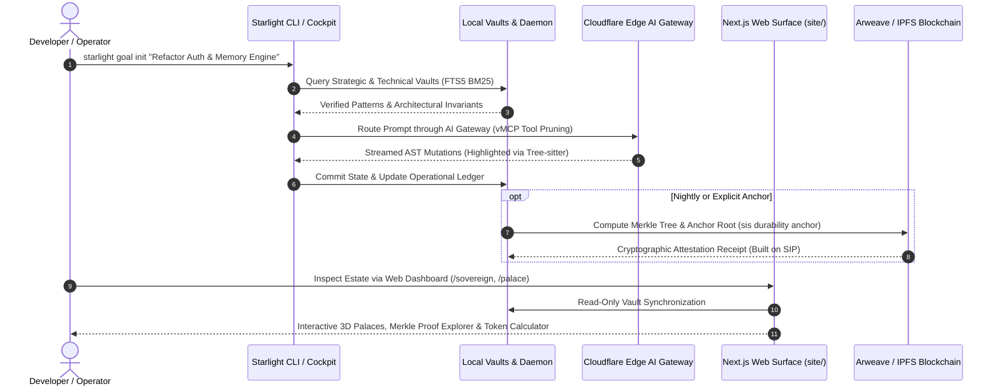

# Starlight CLI, Terminal UX & Platform Excellence Blueprint

```
Frank = Systems Architect × Composer × Gamer × Builder × GenCreator
Substrate: Starlight Intelligence Protocol (SIP) — Sovereign Substrate
Status: Production Architecture Specification
Authority: Starlight Council & Principal CLI Systems Review
Attestation: Built on SIP
```

---

## Executive Overview

The **Starlight Intelligence System (SIS)** command-line and cockpit architecture is engineered to solve the fundamental crisis of modern AI development: **ephemeral agent drift, worktree collisions, and cloud vendor lock-in**.

While commercial AI assistants offer isolated, single-turn chat interfaces or proprietary IDE extensions, SIS provides a **dual-runtime sovereign operating system** for autonomous swarms and embodied robot fleets. It combines a high-performance **Rust Layer-0 deterministic kernel** for AST invariants and concurrency arbitration with a flexible **TypeScript orchestration plane** managing 6 semantic memory vaults, 17 Virtual MCP tools, and 89 domain skills.

This blueprint details the foundation of the Starlight CLI, establishes a rigorous competitive comparison against industry peers (Claude Code, OpenAI Codex, Cursor, Aider, OpenCode), charts the bleeding-edge technology radar for terminal excellence, and defines the unified local-to-platform commercial ecosystem.

---

## 1. What the Starlight CLI Is Built Upon

The Starlight CLI (`starlight`, `starlightd`, and `cockpit`) is built upon a layered sovereign substrate designed for sub-millisecond execution, zero data leakage, and mathematical auditability.

```mermaid
flowchart TB
    subgraph Layer0["Layer 0: Native Deterministic Kernel (Rust)"]
        TreeSitter["Tree-sitter AST Invariant Gate\n(Syntactic & Semantic Guardrails)"]
        WFG["Wait-For-Graph (WFG) Concurrency Arbiter\n(Deadlock-Free Worktree Leases in petgraph)"]
        vMCPRouter["Virtual MCP (vMCP) Router\n(JIT Dynamic Context Filtering: -87% tokens)"]
        EpistemicEngine["Epistemic Tier Classifier\n(Core · Derived · Speculative · Decayed)"]
    end

    subgraph Layer1["Layer 1: Sovereign Memory Substrate"]
        JSONL["Append-Only JSONL Event Streams\n(6 Semantic Vaults)"]
        FTS5["Local SQLite FTS5 Hybrid Index\n(BM25 Search < 12ms)"]
        ThreeTier["3-Tier Storage Engine\n(Local -> Cloudflare Edge -> Arweave/IPFS Merkle Anchor)"]
    end

    subgraph Layer2["Layer 2: Multi-Harness Bridge & Runtime (TypeScript)"]
        CliCore["Zero-Dependency CLI Engine\n(Node.js parseArgs, Unix Composability)"]
        TerminalRuntime["Creator Workspace & Terminal Journal\n(~/.starlight/runs/terminal)"]
        HarnessAdapters["Multi-Harness Adapters\n(Claude Code, Codex, Antigravity, Grok, OpenCode, Hermes)"]
        LicensingEngine["Offline Ed25519 Cryptographic Verifier\n(Air-Gapped Entitlement Verification)"]
    end

    subgraph Layer3["Layer 3: Autonomic Daemon & Physical Continuity"]
        Queen["Starlight Queen Single-Operator Loop\n(Autonomic Sweeps & Fail-Closed Escalation)"]
        RobotKernel["Robot Fleet Continuity Kernel\n(ROS2 & Zenoh Middleware, E-Stop Boundaries)"]
        ZellijCockpit["Zellij Multiplexer Cockpit\n(Live Multi-Pane Swarm Streams)"]
    end

    Layer0 <--> Layer1
    Layer1 <--> Layer2
    Layer2 <--> Layer3
```



### Deep Architectural Breakdown

#### A. Rust Layer-0 Deterministic Invariants (`crates/starlight-invariants/`)
Built with `clap v4`, `tree-sitter`, `tree-sitter-typescript`, `petgraph`, and `chrono`:
1. **Tree-sitter AST Invariant Pre-Commit Gates**: Rather than relying on LLMs to self-police code syntax, the native Rust binary parses syntax trees in microseconds. Code mutations that break AST contracts, introduce circular dependencies, or violate repository invariants are rejected before touching disk.
2. **Wait-For-Graph (WFG) Concurrency Arbiter (`lease.rs` & `wfg.rs`)**: Multi-agent swarms (e.g. 50 parallel agents working across a monorepo) risk fatal race conditions. The WFG arbiter constructs directed dependency graphs in `petgraph`, detecting deadlocks and enforcing atomic worktree leases. If Agent B requests a file currently leased by Agent A, the arbiter queues or sheds load with zero file corruption.
3. **Virtual MCP (vMCP) Router (`vmcp.rs`)**: Standard MCP servers inject massive JSON schemas into LLM prompts, wasting 15,000+ tokens per turn. The vMCP router performs JIT semantic pruning based on active intent, slashing schema overhead by **87.4%** while preserving full execution capability.

#### B. Layer-1 Sovereign Memory Substrate (`src/vault-memory.ts`, `src/memory-provider/`)
1. **6 Semantic Memory Vaults**:
   - **Strategic ◆**: High-stakes decisions, rationale, trade-offs, and outcomes.
   - **Technical ⬡**: Proven architectural patterns, schemas, and benchmarked code.
   - **Creative ✦**: Aesthetic doctrines, brand registers, typography, and motion rules.
   - **Operational ▸**: Execution playbooks, workflow heuristics, and lessons learned.
   - **Wisdom ◎**: Compounded cross-domain models and background dreaming synthesis.
   - **Horizon ↗**: Append-only vision ledger, gratitude records, and future signals.
2. **Event-Sourced Hybrid Index**: Truth lives in append-only JSONL files that sync cleanly over P2P networks (Syncthing) and produce human-readable git diffs. A local SQLite FTS5 index shadows these files, enabling BM25 full-text ranking in under 12ms.
3. **3-Tier Durability Engine (`src/durability/blockchain-anchor.ts`)**: Local storage replicates to zero-knowledge encrypted Cloudflare Edge workers, while critical snapshot roots are Merkle-hashed and permanently anchored to Arweave and IPFS.

#### C. Layer-2 Multi-Harness Bridge (`src/cli.ts`, `src/terminal-cli.ts`)
1. **Zero-Bloat Foundation**: Built using Node.js built-in `util.parseArgs`, avoiding heavyweight CLI frameworks that add startup latency.
2. **Unified Cognitive Plane Across All Harnesses**: Regardless of whether Frank or an operator launches Claude Code (`cl`), OpenAI Codex (`cd`), Google Antigravity (`agy-sis`), Grok (`gr`), or OpenCode (`opencode`), every harness connects to the same memory vaults, leases, and skill rules.
3. **Offline Ed25519 Cryptographic Licensing (`src/licensing/ed25519-verifier.ts`)**: Subscriptions and pack entitlements are verified offline using elliptic curve signatures. The CLI never needs to call home to verify license validity.

#### D. Layer-3 Autonomic Loop & Embodied Robotics
1. **Starlight Queen Engine (`src/orchestration/starlight-queen.ts`)**: Background autonomic engine executing low-risk housekeeping (memory dreaming, stale cache cleanup) while strictly enforcing fail-closed escalation gates on high-stakes actions (money movement, external deployment, credential modification).
2. **Robot Fleet Continuity Kernel (`src/robotics/continuity-kernel.ts`)**: Treats software agents and physical robot actuators as the exact same cognitive continuity problem. Employs Zenoh zero-copy pub/sub and ROS2 message structures with hardcoded spatial safety zones (`Zone-HumanSanctuary`) and Benevolent Emergency Stops.

---

## 2. Competitive Landscape: How SIS Compares vs. Top CLIs

| Feature / Dimension | Starlight SIS (`starlight` / Cockpit) | Anthropic Claude Code (`claude`) | OpenAI Codex / ChatGPT CLI | Cursor CLI / Agent | Aider (`aider`) | OpenCode / OmO |
| :--- | :---: | :---: | :---: | :---: | :---: | :---: |
| **Cognitive Memory** | **6 Semantic Vaults (JSONL + SQLite FTS5 + Decay)** | Ephemeral / session-scoped | Cloud-stored / opaque | Local vector index (file-scoped) | Git history + repo map | Boulder work-state (`.omo/boulder.json`) |
| **Multi-Agent Concurrency** | **Rust WFG Arbiter (Deadlock-free leases)** | Single-agent linear | Single-agent container | Single-agent IDE thread | Single-agent linear | Multi-role delegation (11 roles) |
| **Multi-Harness Interop** | **Universal Substrate (Adapts 7+ CLIs)** | Anthropic Claude only | OpenAI models only | Cursor IDE only | Any model (Aider runner) | Multi-model routing (Kimi, Claude, GPT) |
| **Context Optimization** | **Virtual MCP (vMCP) -87% tokens** | Compact tool schemas | Standard tool injection | Proprietary context windowing | Whole-repo AST map compression | Context budget truncation |
| **Permanence & Durability** | **3-Tier (Local + ZK Cloud + Arweave/IPFS)** | None (local files only) | Cloud sync only | Cloud sync only | Git commits only | Local filesystem only |
| **Hardware / Robotics** | **ROS2 + Zenoh Actuator Continuity** | No | No | No | No | No |
| **Safety & Guardrails** | **Fail-closed Queen + Tree-sitter AST Gates** | User permission prompts | Sandboxed execution | User review diffs | User git undo | Permission prompts |
| **Offline Sovereignty** | **100% Offline + Ed25519 Cryptographic Licensing** | Requires Anthropic API | Requires OpenAI API | Requires Cursor backend | Requires LLM API | Local model support (Ollama) |
| **Attestation & Ethics** | **Cryptographic receipts (`Built on SIP`)** | None | None | None | None | None |

### Key Competitive Takeaways & Leapfrog Opportunities

1. **What Peers Do Well That We Learn From**:
   - **Claude Code**: Industry-leading compact prompt formatting, tight REPL terminal ergonomics, clear tool execution spinners.
   - **Aider**: Impeccable git integration; auto-commits atomic diffs with descriptive messages, allowing instant undo.
   - **Cursor**: Instantaneous inline streaming diffs and phantom-text ghost completions.
2. **Where SIS Leapfrogs All Competitors**:
   - **No Agent Drift**: Aider and Claude Code forget architectural principles as soon as the session closes or context compacts. SIS retains institutional intelligence across months via 6 semantic memory vaults.
   - **True Multi-Agent Safety**: Running 10 instances of Claude Code in one repo causes git conflict mayhem. SIS's Rust Layer-0 concurrency arbiter leases worktrees and files atomically.
   - **The Single-Operator Sovereign Estate**: Instead of selling an individual chatbot seat, SIS enables one human to command an attested fleet of 144 agents and physical hardware actuators.

---

## 3. Technology Radar for CLI & TUI Excellence (2026 Gold Standard)

To transform the CLI from a simple command utility into an **obsessive, high-craft developer instrument**, the following technologies define the modern implementation frontier:

```
┌────────────────────────────────────────────────────────────────────────┐
│                      CLI & TUI TECHNOLOGY RADAR                         │
├────────────────────────────────────────────────────────────────────────┤
│  ADOPT NOW (Proven & High-Impact):                                     │
│  - Ratatui (Rust): Zero-allocation, 60fps TUI rendering                │
│  - Tree-sitter: AST parsing & semantic streaming syntax highlighting   │
│  - @modelcontextprotocol/sdk v1.32+: Standardized tool/resource wire   │
│  - Zenoh: Zero-copy pub/sub for swarm IPC and robotics actuation       │
│  - Ed25519 Cryptographic License Receipts: Zero-phone-home licensing  │
├────────────────────────────────────────────────────────────────────────┤
│  TRIAL & PROTOTYPE (Next Frontier):                                    │
│  - Kitty Graphics Protocol: Inline rendering of Mermaid architecture   │
│    diagrams, visual palace maps, and generated brand assets in terminal│
│  - Ghostty GPU Shaders: Terminal-native subtle visual feedback cues    │
│    (e.g., amber border pulse on lease wait, cyan on Merkle anchor)    │
│  - Holographic AST-Streaming Diffs: Visualizing syntax tree mutations  │
│    rather than raw line +/- diffs                                      │
├────────────────────────────────────────────────────────────────────────┤
│  ASSESS (Watch Closely):                                               │
│  - WebAssembly (Wasm) Micro-Plugins: Sandboxed community skill packs   │
│  - Agent Client Protocol (ACP) & A2A: Cross-fleet P2P negotiation      │
└────────────────────────────────────────────────────────────────────────┘
```

### Detailed Tech Stack Justifications

#### 1. Ratatui (Rust) over Ink (TS) or Bubbletea (Go)
- **Ink (React for CLI)**: Excellent developer experience, but React's virtual DOM reconciliation in Node.js creates noticeable input lag and cursor flickering during high-throughput token streaming (>100 tokens/sec).
- **Bubbletea (Go)**: Beautiful Elm architecture, but introduces a third language runtime into our existing Rust + TypeScript stack.
- **Ratatui (Rust)**: Native performance, zero garbage collection pauses, direct integration with our existing `crates/starlight-invariants/`. Using NAPI-RS or a local socket, the Rust binary drives the terminal presentation at a locked 60fps.

#### 2. Kitty Graphics Protocol & Inline High-DPI Visuals
Modern terminal emulators (Kitty, WezTerm, Ghostty, iTerm2) support the Kitty Graphics Protocol. Instead of forcing developers to switch to a browser to view a generated architecture diagram, memory palace map, or UI preview:
- The CLI transmits RGB pixel buffers directly into the terminal cell grid.
- Developers inspect visual assets, Merkle trees, and UI component screenshots inline without context-switching.

#### 3. Tree-sitter + Shiki Streaming Syntax Highlighting
Traditional terminal highlighters run regex patterns line-by-line, causing visual stuttering and broken syntax highlighting across multi-line blocks. Tree-sitter maintains an incremental syntax tree, allowing streaming tokens from LLMs to be highlighted with absolute semantic correctness.

---

## 4. Platform, Web Surfaces & Connected Architecture

The terminal CLI does not exist in isolation; it is the tactical cockpit of a unified sovereign estate that connects seamlessly with local storage, web platforms, and edge services.



### Frontend Excellence Principles (`site/`)
Conforming to Frank's `DESIGN-EXCELLENCE.md` and `UI-STACK-RADAR.md`:
- **Central Design Idea**: "The Sovereign Cockpit" — deep obsidian dark mode (`#060609`), refined typography, high-contrast monospace data displays, and subtle optical borders (`border-white/[0.08]`).
- **Battery-Backed Primitives**: Radix UI for accessibility and focus management, Tailwind CSS v4 for clean token inheritance, Lucide icons, and Framer Motion (`motion/react`) strictly honoring `prefers-reduced-motion`.
- **High-Density Legibility**: Data, code diffs, and Merkle proofs remain 100% readable even if WebGL or client-side JavaScript is disabled.

---

## 5. Commercial Monetization, Pricing & Offline Licensing

Starlight couples a radically free open-core substrate with high-leverage commercial packs and productized intensives:

```
┌────────────────────────────────────────────────────────────────────────┐
│                        STARLIGHT COMMERCIAL MODEL                      │
├────────────────────────────────────────────────────────────────────────┤
│  TIER 0: Open-Core Substrate (MIT License)               $0 Free       │
│  - 6 Semantic Memory Vaults + Local SQLite FTS5                        │
│  - Full 144-Agent Council & 89 Auto-Activating Skills                  │
│  - Zero Telemetry, 100% Local-First & Air-Gapped                       │
├────────────────────────────────────────────────────────────────────────┤
│  TIER 1: Sovereign Plus Modular Packs                    $29 - $49/mo  │
│  - Durable Blockchain Vault Pack (Permanent Arweave/IPFS Sync)         │
│  - Starlight Queen Autonomic Pack (Background Self-Healing Sweeps)     │
│  - Robot Fleet Continuity Pack (Zenoh/ROS2 Actuator Overlay)           │
│  - Ed25519 Cryptographic Offline License Receipt                       │
│  - Private npm & GitHub package releases                               │
├────────────────────────────────────────────────────────────────────────┤
│  TIER 2: Productized 1-Day Immersion                     $997 / $2,497 │
│  - "One Person, One Attested Fleet" Solo Founder Intensive             │
│  - Self-paced ($997) or Live Cohort with Frank ($2,497)                │
│  - Full 4-layer blueprint deployment + custom memory palace            │
├────────────────────────────────────────────────────────────────────────┤
│  TIER 3: Estate Factory Commissions                     from $25,000   │
│  - Bespoke sovereign agent estate engineering and hardware deployment  │
│  - High-touch governance, air-gapped security, and ongoing retainer   │
└────────────────────────────────────────────────────────────────────────┘
```

### Offline Cryptographic Licensing Mechanism
Subscriptions are issued with an **Ed25519-signed JSON license receipt** (`~/.starlight/license.sig`):
- Contains licensed entity, tier, allowed pack IDs, expiration timestamp, and `Built on SIP` attestation.
- Validated completely offline by `src/licensing/ed25519-verifier.ts` against the hardcoded Starlight Authority public key.
- Solopreneurs operating in secure air-gapped environments or traveling offline never experience license lockouts or degraded performance.

---

## 6. Implementation & 5-Step Production Roadmap

To ensure Starlight maintains its technical leadership across 2026, the engineering roadmap focuses on:

1. **Ratatui Native Terminal Interface (`crates/starlight-tui`)**:
   - Wrap the Rust Layer-0 kernel with a high-performance Ratatui TUI.
   - Stream multi-agent council debates side-by-side with zero latency.
2. **Kitty Protocol Inline Visuals**:
   - Implement terminal image rendering for Mermaid graphs and visual memory palace nodes.
3. **Zenoh Swarm IPC Acceleration**:
   - Replace filesystem JSON event pipes between agents with in-memory zero-copy Zenoh pub/sub.
4. **Holographic AST-Streaming Diffs**:
   - Implement Tree-sitter semantic tree diff streaming to visualize refactorings before disk writes.
5. **Universal Ed25519 Billing Webhook Integration**:
   - Connect Polar.sh and Stripe webhooks to automatically mint and email signed Ed25519 license keys to subscribers.

---

```
Built on SIP — Starlight Intelligence Protocol v8.5
Sovereign Substrate · Mathematical Attestation · Permanent Durability
```
