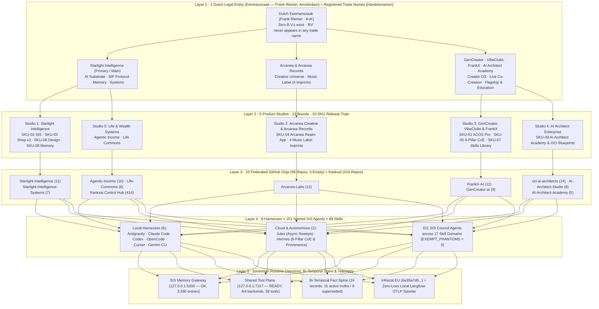

# Starlight Estate Architecture & Documentation Atlas (v9.3 · October 2026)

> **Interactive HTML5/SVG Live Surface:** [`/atlas/index.html`](../../site/public/atlas/index.html) (`https://starlightintelligence.org/atlas/index.html`)  
> **Agent-Readable Manifest:** [`/llms.txt`](../../site/public/llms.txt) · **Bi-Temporal Fact Ledger:** [`memory/vaults/temporal-facts.jsonl`](../../memory/vaults/temporal-facts.jsonl)

---

## 1. Design & Engineering Standard: Dual-Consumer (Human + Agent) Architecture

Modern documentation and architecture systems must serve **two first-class consumers simultaneously** without duplicating maintenance or inflating cloud hosting costs:

1. **Human Operators & Architects (Desktop + Mobile Touch):**
   - **Unblocked (`getunblocked.com`) Code-to-Decision Provenance:** Clicking or tapping any node in `/atlas/index.html` reveals *why* it exists, the exact file path, the GitHub PR/SHA receipt, the automated test gate, and the **historical misconception it superseded**.
   - **Linear (`linear.app/docs`) & Stripe (`docs.stripe.com`) Visual Craft:** `#060609` deep cosmic obsidian canvas, `1px` `rgba(255,255,255,0.08)` hairlines, keyboard-first navigation (`/` search, `1`–`5` view switching), and side-by-side live CLI commands.
   - **Gemini 4 Argon Mobile HTML5 + SVG Vector Engine:** Zero-dependency vector schematics (`viewBox="0 0 1200 760"`) with animated cubic-bezier packet flows (`stroke-dasharray`), 1-finger touch pan, 2-finger pinch-to-zoom, and instant `<15ms` static edge delivery.
2. **AI Agents & Harnesses (Local & Cloud):**
   - **Two-Artifact Turn-0 Core (`tools/compile-turn0-core.mjs`):** Compiles Turn-0 instructions into `Doctrine <= 8 KB` (`3,495 B`) + `Catalog <= 8 KB` (`4,730 B`) = **`2,057 tokens` total** (a **96.9% reduction** from legacy 50k–83k token boots), paired with `GEMINI.md` (`8,214 B`) and Codex `project_doc_max_bytes = 98304`.
   - **Bi-Temporal Fact Spine (`src/memory/temporal-spine.ts` & `memory/vaults/temporal-facts.jsonl`):** Tracks `tValid`, `tInvalid`, `tCreated`, `tExpired`, and `supersededBy` pointers so outdated assumptions are automatically invalidated when estate state changes.
   - **Citation-Stable Raw Endpoints:** `/llms.txt`, `/sip.md`, `/protocol.md`, and one-click `Copy for LLM` inside `/atlas/index.html`.

---

## 2. Five-Layer Sovereign Topology

---

## 3. Documentation & Wiki FinOps Economics (Vercel vs. Vite/Astro vs. Fumadocs vs. DeepWiki vs. Unblocked)

| Stack / Layer | Role in Starlight Estate | Monthly Cost | Performance & Agent Benefit |
| :--- | :--- | :---: | :--- |
| **Static HTML5/SVG Atlas (`site/public/atlas/index.html`)** | Interactive 5-layer topology, Unblocked-style provenance inspector, Turn-0 simulator, and Argon prompt studio | **$0 / mo** *(0 Vercel Fluid Compute invocations)* | `<15ms` CDN edge delivery, 60fps mobile touch pan/zoom, zero JS framework hydration overhead |
| **Next.js Static Routes + Fumadocs Pattern (`site/src/app/docs` & `/architecture`)** | Public protocol, quickstart, and architecture narrative on `starlightintelligence.org` | **$0 / mo incremental** *(covered by existing Vercel project, cached via `revalidate = 3600`)* | Paired with `/llms.txt`, `/sip.md`, and `/protocol.md` raw Markdown endpoints |
| **Bi-Temporal Fact Spine (`src/memory/temporal-spine.ts`)** | Replaces paid Unblocked SaaS (`$25–$40/seat/mo`) for cross-session code-to-decision provenance | **$0 / mo** *(git-tracked JSONL)* | Zero Neo4j RAM overhead, zero LLM extraction cost, deterministic Turn-0 injection |
| **DeepWiki (`deepwiki.com/<org>/<repo>`)** | Automated repo wiki & call-graph mirror for all **96 public repos** across our 10 GitHub Orgs | **$0 / mo** *(100% free for public GitHub repos)* | Instant zero-maintenance onboarding graphs for external contributors and DeepWiki MCP queries |
| **Vite / Astro Starlight on GitHub Pages / Cloudflare Pages** | Standalone documentation sites for individual OSS packages in our 10 GitHub Orgs | **$0 / mo** *(unlimited static bandwidth)* | Isolates OSS package docs from Vercel build-minute quotas |

---

**Built on SIP** · Verified `2026-10-18` (`SIS#451` @ `9840daab1`, `SIS#452` @ `7bea14863`, `agentic-ops-hub#363` @ `22181a5`).
