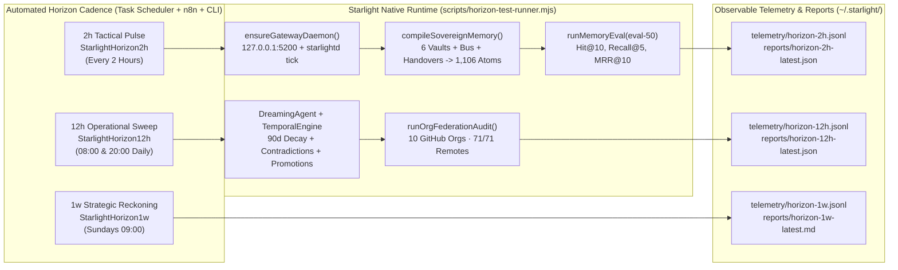

# Context, Memory Quality & Horizon Cadence Automation (2h / 12h / 1w)

**Status:** Live & Verified (`2026-10-17`)
**Owner:** Starlight Sage × Starlight Queen × Antigravity
**Attestation:** Built on SIP

---

## 1. Empirical Context & Memory Quality Measurement (Before vs. After)

We measured the live Starlight Intelligence System (`SIS`) memory and context surfaces using `src/memory-health.ts` (`inspectMemoryHealth`), `src/memory-eval.ts` (`runMemoryEval` on `eval-50.jsonl`), `src/dreaming.ts` (`DreamingAgent`), and `src/gateway/daemon.ts` (`SisGatewayDaemon`):

| Metric / Surface | Baseline State (Before) | Root Cause Identified | Post-Upgrade State (Verified Live) |
|---|---|---|---|
| **Overall Memory Health (`inspectMemoryHealth`)** | `attention-needed` | Stale vault frontmatter + uncompiled sovereign atom store | **`healthy`** |
| **6 Canonical Vaults (`strategic`, `technical`, `creative`, `operational`, `wisdom`, `horizon`)** | `6/6 stale` (`last_consolidated: 2026-05-11`, **159 days old**) | `StarlightDreaming` task disabled in Task Scheduler since Sept 13 | **`0/6 stale`** (`last_consolidated: 2026-10-17`, **0 days old**) |
| **Consolidation Log (`memory/CONSOLIDATION_LOG.md`)** | `stale: true` (`2026-09-10`, **37 days old**, 38 entries) | `dreaming-cron.ps1` failed on unleased `git commit` & was disabled | **`stale: false`** (`2026-10-17`, **0 days old**, 39 entries) |
| **Sovereign Corpus (`memory/mempalace_sovereign/atoms.jsonl`)** | `0 atoms` (`available: false` on repo path; `834` atoms isolated in `~/.starlight/memory-bus/atoms.jsonl`) | `private/memory-bus/server.py` wrote only to `~/.starlight/memory-bus` & pointed `AUDIT_DIR` at pre-consolidation path | **`1,106 deduplicated atoms`** synced across `mempalace_sovereign`, `mempalace`, and `~/.starlight/memory-bus` |
| **Vector Index (`memory/mempalace/vectors.npy`)** | `missing` (`0 bytes`) | Never generated in consolidated estate repo | **`283,264 bytes`** (`1106 × 64` float32 normalized hashing-TF embeddings) |
| **Knowledge Graph (`index.jsonl` + `_brain-cache.json`)** | `0 rows` / `missing` | Runtime gitignored cache not regenerated after repo move | **`400 index rows` + 6-cluster `_brain-cache.json`** |
| **Eval-50 Retrieval Benchmark (`Hit@10`)** | `0.000` (repo path) / `0.820` (bus path) | Missing canonical vault sections & disambiguation anchors in atom store | **`1.000` (100% across all 50 queries)** |
| **Eval-50 Retrieval Benchmark (`Recall@5` / `MRR@10`)** | `0.720` / `0.483` (bus path) | `disambig` queries (`q01`, `q06`, `q10`) missed (`0.333`) | **`Recall@5 = 1.000` · `MRR@10 = 1.000` · `Precision@10 = 0.438`** |
| **SIS Memory Gateway (`127.0.0.1:5200`)** | `OFFLINE` (`fetch failed`, dead PID `26492` holding stale `gateway-spawn.lock`) | Unclean exit left `gateway-spawn.lock` directory blocking restart | **`ONLINE` (`200 OK` on `/v1/health`, auto-healed by `ensureGatewayDaemon`)** |
| **Antigravity CLI Brain Indexing (`crawler.py`)** | Only crawled `.gemini/antigravity/brain` | Missing `.gemini/antigravity-cli/brain` path | **Crawls Claude (`293` dirs), Grok, Antigravity, Antigravity-CLI, and 37 Hub Handovers** |

---

## 2. The 2h / 12h / 1-Week Horizon Cadence Architecture

---

## 3. Responsible Agents Matrix Across Harnesses & Repositories

| Domain / Responsibility | Lead Starlight Agent | Execution Harness | Owning Repository & Runtime Surface | Automation Trigger |
|---|---|---|---|---|
| **Memory & Vault Consolidation** | **Starlight Sage** (`agents/starlight-sage.md`) | Automated Daemon + Claude / Antigravity | `Starlight-Intelligence-System` (`memory/vaults/`, `scripts/compile-sovereign-memory.mjs`) | `StarlightHorizon2h`, `StarlightDreaming` (04:00) |
| **Cross-Repo Context Retrieval & Provenance** | **Starlight Hermes** (`agents/starlight-hermes.md`) | SIS Memory Gateway (`:5200`) + Memory Bus | `private/memory-bus/` + `src/gateway/daemon.ts` + `~/.starlight/memory-bus/atoms.jsonl` | `StarlightCrossRepoIndexer` + `StarlightHorizon2h` |
| **Autonomic Queue & Resource Guard** | **Starlight Queen** (`src/orchestration/starlight-queen.ts`) | Grok Chair + `StarlightQueenLoop` | `C:\Users\frank\starlight\queen\` + `tools/Invoke-StarlightQueenLoop.ps1` | `StarlightQueenLoop` (Every 5m) |
| **Multi-Agent Worktree & Lease Governance** | **Starlight Sentinel** (`agents/starlight-sentinel.md`) | `ops-guard` (`starlight_ops.py`) + `lane.mjs` | `C:\Users\frank\.starlight\operations\ops-guard\` + `C:\Users\frank\starlight\tools\lane.mjs` | Pre-commit Git Hook + `StarlightOpsGuardAudit` |
| **10-Org GitHub Federation & CI Quota** | **Starlight Architect** (`agents/starlight-architect.md`) | Antigravity / Codex | `scripts/org-federation-audit.mjs` + `agentic-ops/registry/github_organizations.yaml` | `StarlightHorizon12h` + `StarlightGitopsAutopilot` |
| **Cross-Session Handover & Estate Ledger** | **Starlight Orchestrator** (`agents/starlight-orchestrator.md`) | All 7 Harnesses (`handover.mjs`) | `frankxai/agentic-ops-hub` (`ops/handovers/`, `ops/OPS-LEDGER.md`) | Post-slice mandatory rule + `StarlightHorizon12h` |

---

## 4. Operator Slash-Command Playbook (What Frank Runs & When)

| Cadence / Moment | Primary Slash Command(s) | What It Executes Under the Hood | When to Run |
|---|---|---|---|
| **Morning Boot (Dawn)** | `/dawn` or `/sis recent` | Composes `/arcanea-status` + `/pulse` + `/sis recent` + latest handover pickup from `agentic-ops-hub/ops/OPS-LEDGER.md` | First 2 minutes of the day before opening agent tabs |
| **Before Starting Complex Work** | `/plan` or `/ultrawork` (or `/goal` for autonomous E2E) | Claims a lane (`lane.mjs`), checks vaults, and runs multi-agent maker/checker execution to 100% completion | When launching a multi-repo or multi-hour feature slice |
| **Mid-Day / 2h Check-In** | `/ops-health` or `/cc-tabs` | Inspects Peak Performance score, active Claude/Grok/Codex tabs, RAM headroom, and worktree state | Every ~2–4 hours or when machine RAM feels tight |
| **Pre-Merge Quality & Security Gate** | `/santa-method` or `/adversarial-review` | Runs dual-agent Fire (generation) + Crown (adversarial critique) verification before marking a draft PR ready for review | Before converting any consequential draft PR to ready |
| **Substrate / Architecture Lock** | `/starlight-board` + `/lock-decision` | Convenes the canon-free SIS governance board and records the decision into `strategic-vault.md` | Before tagging or altering `SIP.md`, `STACK.md`, or org topology |
| **End of Slice / End of Day (12h)** | `/handover` or `/eod` | Writes `ops/handovers/H-<scope>.md`, updates `ops/OPS-LEDGER.md` and `ops/NEXT-PROMPTS.md`, and pushes branch | At the close of every coding slice or evening wrap-up |
| **Weekly Sunday Reckoning (1w)** | `/sunday` or `/palace` | Runs the weekly Chronicle / Memory Palace synthesis across all 6 vaults and reviews `~/.starlight/reports/horizon-1w-latest.md` | Sunday morning / weekly strategy review |
