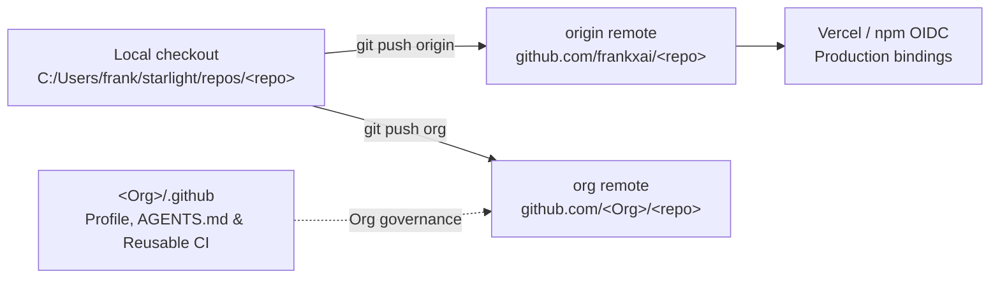

# GitHub organization federation architecture (2026-10-17)

## Context and problem statement

The Starlight estate operates across ten domain-specific GitHub Organizations alongside the `frankxai` account:

1. **`Starlight-Intelligence`** — Personal AI command center, memory routing, voice runtime, cross-harness agent configuration, design intelligence, and evaluation harnesses.
2. **`Starlight-Intelligence-Systems`** — Sovereign substrate, Starlight Intelligence Protocol (SIP), six-vault cognitive architecture, swarm coordination, knowledge tree, and public research.
3. **`Arcanea-Labs`** — Creative worldbuilding framework, web platform, generative media studio, multi-agent creative orchestrator, and on-chain provenance.
4. **`GenCreator-ai`** — Agentic Creator OS (ACOS), GenCreator Studio, creator skill packs, launch storefront templates, and creator MCP servers.
5. **`FrankX-AI`** — Flagship `frankx.ai` web platform, book authoring pipelines, prompt library, Claude Code hooks, skill libraries, and MCP diagnostics.
6. **`AI-Architect-Studio`** — Enterprise AI architecture lifecycle, six-pillar AI Center of Excellence (CoE) reference kits, field guides, and agent operating standards.
7. **`AI-Architect-Academy`** — Hands-on AI architecture curriculum, kata labs, and operator training tracks.
8. **`Agentic-Income`** — Digital product monetization catalogs, transparent comparison templates, FTC-compliant affiliate skills, and local-first investor research (`GenInvestor`).
9. **`Life-Commons`** — Source-led knowledge commons across ocean intelligence, paleobiology, personal health, observational mind modeling, and family history.
10. **`oci-ai-architects`** — Community-built OCI AI Architect reference patterns, skill packs, and one-click OpenTofu/Terraform stacks.

### Why dual-remote federation (`origin` + `org`) is required

Per `agentic-ops/docs/decisions/repository-and-organization-boundaries-2026-10-10.md`:
- **41 Vercel projects** on the `Starlight Intelligence` Pro team are bound to `frankxai/*` GitHub repository IDs.
- **npm OIDC trusted publishing** for `@starlight-intelligence/sis` and companion packages is bound to `frankxai/*` workflow identities.
- Blindly calling `POST /repos/frankxai/<repo>/transfer` into a GitHub Free organization breaks Vercel webhook bindings and alters private-repository Actions billing rules.

Instead of leaving the domain organizations empty or breaking Vercel deployments via destructive transfers, the estate uses **Dual-Remote Organization Federation**:



## Core invariants

### 1. Strict visibility parity (non-waivable)
Every federated organization repository (`<Org>/<repo>`) must match or exceed the privacy of its source repository (`frankxai/<repo>`):
- `frankxai/<repo>` `private: true` -> `<Org>/<repo>` **must** be `private: true`.
- `frankxai/<repo>` `private: false` -> `<Org>/<repo>` is `private: false`.
- Public organization profile READMEs (`<Org>/.github/profile/README.md`) list **only** public repositories and never disclose private repository names or internal operational details.

### 2. Standardized `<Org>/.github` governance repository
Every active GitHub Organization maintains a public `.github` repository containing:
- `profile/README.md` — Sentence-case, brand-aligned organization landing page with Mermaid system topology, public repository table, and quickstart commands.
- `AGENTS.md` — Organization-wide agent operating contract inheriting Starlight Band A, brand voice rules, worktree/lane discipline, and Maker != Checker verification.
- `CONTRIBUTING.md`, `SECURITY.md`, `CODE_OF_CONDUCT.md`, `SUPPORT.md` — Default community health files inherited by all repositories in the organization.
- `.github/PULL_REQUEST_TEMPLATE.md` — Pull request receipt requiring `Intent:`, `Maker-Harness:`, `Checker-Harness:`, and local verification checkboxes.
- `.github/ISSUE_TEMPLATE/` — Structured YAML issue forms (`bug_report.yml`, `agent_slice.yml`, `config.yml`).
- `.github/workflows/reusable-ci.yml` — Draft-gated reusable CI workflow (`if: github.event_name != 'pull_request' || github.event.pull_request.draft == false`) with `cancel-in-progress: true` concurrency and a 10-minute timeout bound.

### 3. Local multi-remote wiring
Every federated repository checkout in `C:/Users/frank/starlight/repos/<repo>` carries two standard remotes:
- `origin`: `https://github.com/frankxai/<repo>.git` (or `<Org>/<repo>.git` for org-primary repositories such as `Starlight-Intelligence/starlight-command-center` and `oci-ai-architects/*`)
- `org`: `https://github.com/<Org>/<repo>.git`

## Verification command

Run the deterministic federation audit CLI from `Starlight-Intelligence-System`:

```bash
# Audit local git remote wiring across all 10 organizations
node scripts/org-federation-audit.mjs

# Idempotently wire missing local 'org' remotes
node scripts/org-federation-audit.mjs --wire-local
```
