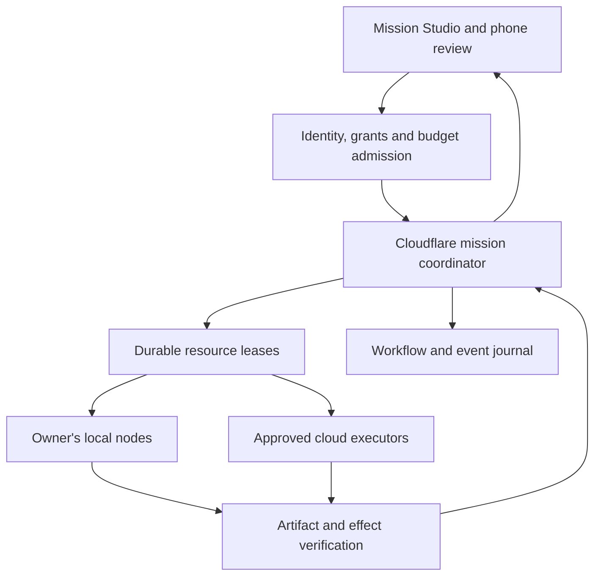

# Nexus: continuous work across machines, models and people

Revised 31 October 2026. Proposal and implementation plan; not a hosted-service availability claim. This document replaces the earlier direction in draft PR #476 while preserving its Git history.

**Nexus should let a founder direct one persistent mission across their own computers, cloud workers and collaborators, with inspectable context, bounded authority and a verified result.** A mission can outlive the terminal that started it. The owner can change the brief, review the affected artifacts and resume on a permitted executor without reconstructing the project from chat fragments.

## Product boundary and names

| Name | Responsibility | Source owner |
| --- | --- | --- |
| Starlight Intelligence | Customer platform, missions, workspace and commercial relationship | Existing Starlight product repositories |
| Nexus | Execution continuity: node connection, placement, leases, checkpoint references and handoff evidence | Existing SIS reference runtime; product-facing integration in starlightintelligence.ai |
| Starlight Intelligence Network | Existing federation name for people, their intelligence systems, attested artifacts, shared research and permitted memory connections | Existing network naming in NAMING.md; no separate company, repository or ledger |
| SIP | Existing portable substrate and interoperability contracts | Existing SIS protocol governance, unchanged by this proposal |

Use “Nexus” for the execution module. Preserve the existing full name “Starlight Intelligence Network” and its registered short form “Starlight Network” from [NAMING.md](../../../NAMING.md). Avoid making “SIN” the public label: it adds another acronym before it adds understanding. The wider federation includes people, research and shared artifacts; Nexus supplies its execution-continuity capability. This proposal creates no new brand or protocol version. Network usage remains linked to [SIP v1.1.1](https://starlightintelligence.org/protocol).

The initial customer is a technical founder or small product team already using coding agents. The first job is: **continue this repository improvement on an approved executor and return a tested, reviewable PR.** The broader network becomes valuable through repeated completion of this job.

## Why this opportunity now

YC's Fall 2026 Requests for Startups explicitly describes multiplayer AI: shared, long-running agent work that colleagues can observe, redirect and hand off. This supports the market thesis; it is not an endorsement or demand validation for Starlight. Cloudflare's Agents documentation, updated 29 October, supplies durable identities, local SQL, realtime connections and recoverable execution. The commodity runtime is becoming substantially stronger. Our product must prove continuity, control and accepted work above it.

The signature demonstration is operationally specific. Begin a change on a laptop. Checkpoint a clean repository revision and the remaining task graph. Disconnect that node. Resume on an approved always-on executor. Reject a late result from the expired executor. Review the tested diff from a phone. Change one requirement and retain unaffected artifacts. This demonstration remains a release target; the current change supplies the lease-arbitration component only.

## Architectural decision

Build on Cloudflare for the new persistent coordination boundary. Retain the existing experience, identity and financial authorities while qualifying each integration. Four alternatives were considered:

| Direction | Advantage | Limitation | Decision |
| --- | --- | --- | --- |
| Local daemon plus Git and manual handoffs | Smallest operational surface; useful baseline | Requires human reconstruction and cannot coordinate disconnected nodes authoritatively | Preserve as fallback and comparison baseline |
| Existing coding harness, persistent cloud workspace and GitHub PR workflow | Strong assembled baseline; substantial functionality already available | Cross-executor authority, selective context transfer and requirement-change recovery depend on integration | Benchmark before claiming a Nexus advantage |
| Cloudflare coordination with replaceable local/cloud executors | Durable identity and serialized coordination with owner-controlled execution | Requires real enrollment, revocation, effect fencing and recovery integration | Chosen direction |
| New all-in-one agent OS, scheduler, memory database and generic cloud | Broad surface under one vendor | Duplicates existing owners and delays evidence of one useful outcome | Do not build |

The diagram is the target architecture, not a deployment inventory. A mission owns lifecycle and decisions; a workspace/resource coordinator owns exclusive resource leases. A lease is not a second workflow orchestrator. The financial reservation remains owned by the existing transactional ledger.

## Cloudflare allocation

| Primitive | Nexus workload | Boundary and admission |
| --- | --- | --- |
| Workers | Authenticated ingress, typed APIs, event delivery | No API activation before verified identity and workspace membership |
| Agents / SQLite Durable Objects | Mission identity, realtime state; separate resource-scoped lease serialization | Stable Starlight IDs outside vendor-local identifiers; deterministic state migration |
| Workflows | Agent-owned cross-service steps, review waits, recovery and reconciliation | Exactly one durable workflow owner; external effects remain idempotent operations |
| Queues | Dispatch hints, bursts, retries and dead-letter handling | At-least-once delivery; durable mission/lease state decides whether work may run |
| Sandbox / Containers | Bounded Linux builds and CLI execution | Isolated workspace, egress policy, deadline and cleanup; qualify beta snapshot/scheduling behavior separately |
| Workers for Platforms / Dynamic Workers | Future bounded user-authored utilities | Defer until the mission path works; separate tenant code and secrets |
| R2 | Proposed immutable checkpoint bundles, test logs and portable artifacts consumed by executors | Explicit non-web workload exception; existing web-media defaults stay intact |
| Vectorize / AI Search | Rebuildable retrieval over authorized sources | SQL/source records remain authoritative; filter tenant and rights before retrieval and byte access |
| Workers AI / AI Gateway | Measured specialist inference and a Cloudflare-native route where justified | Preserve the accepted gateway default until a reviewed exception; never chain gateways by default |
| Access / Tunnel | Operator access and selected private service connections | Connectivity does not grant task authority; outbound node polling needs no public laptop endpoint |

Cloudflare's current spend-limit feature is beta and eventually consistent. It cannot implement a hard mission budget. Admission must atomically reserve a bound in the existing ledger, account for retries and reconcile uncertain provider effects. Startup credits subsidize eligible provider charges; they do not create customer entitlement or margin. Current remaining credit, exact coverage and expiry are unverified here.

The accepted Registry remains pinned at `frankxai/agentic-ops@61114141e8c25c0891bef028fbfa38e8e1257742`. This plan follows `architecture_persistent_entity_runtime`, `architecture_durable_execution_boundary`, `architecture_agent_credentials_and_tools` and `architecture_portability_contract`. It proposes workload exceptions to the experience/model/media defaults only where identified; it does not silently replace them.

For R2 checkpoint storage, the workload case is direct local/cloud executor delivery of immutable non-web bundles. Admit only after a reviewed Registry exception names the bucket owner, access policy, retention, jurisdiction and measured cost. Use one canonical byte object per artifact version, with authorized exports explicitly recorded. Migration is opt-in for new checkpoints. Rollback stops new uploads and keeps existing approved artifact storage; retain existing objects until references and retention obligations are reconciled. No media migration is part of this change.

## The special technology we should own

**A portable execution capsule.** Carry the mission and task IDs, exact repository revision, a bounded patch or clean commit, artifact hashes, approved context-source revisions, harness/version requirements, capability constraints, acceptance commands and the next checkpoint. Credentials and whole home directories never travel in the capsule. Resumption creates a new process from explicit state; it does not promise migration of an LLM's hidden state or a live process. A checkpoint from untrusted execution is untrusted input until inspected.

**Leases with fencing generations.** Issue a monotonically increasing generation for exclusive ownership of a canonical workspace resource. Bind it to the tenant, resource, owner and deadline. Renew only the active lease. Once ownership moves, the old owner cannot renew or release the new lease. Every effect receiver must validate the current fence at commit time; a coordinator issuing a fence alone cannot stop a stale process from writing directly to a filesystem or Git provider. Give executors isolated worktrees and route shared publication through an effect broker.

Resource identifiers must be canonical host-owned IDs: this core does not discover overlapping filesystem paths or normalize aliases. Idempotency records live through their immutable operation deadline; operation IDs may be reused after that retention window, so effect deduplication needs its own durable identity. Restarting over current committed storage preserves the fence. Restoring an older backup can rewind it: quiesce executors and rotate the authority epoch/namespace before accepting new effects after such a restore.

**Policy-aware placement.** Eliminate executors that violate data location, tool grants, capabilities, resource limits or fresh attestation before ranking eligible capacity. A device heartbeat is presence evidence, not permission. Laptop execution may still call a remote model; label data egress separately from compute location. Unknown capacity or residency cannot silently become an eligible fallback. Optimize measured accepted completion and total cost, including review, failed attempts and warm-container time.

**A revision-aware work graph.** Version requirements, decisions, source material, artifacts and approvals. Changing an input invalidates its dependent evidence and approval. Preserve independent work. Learn from accepted runs by proposing versioned playbook/routing changes evaluated on held-out cases. Do not let a successful run rewrite its own permissions or silently import another customer's context.

These four mechanisms are the product thesis. Their superiority is unmeasured. The lease core in this PR implements one of the required correctness boundaries; the remaining mechanisms are staged integrations.

## Local-to-cloud and sync semantics

Enrollment should pair an authenticated workspace administrator with a local node public key through a short-lived, single-use challenge. Store private keys in the host's protected credential facility. Node credentials are revocable and limited to explicitly granted resources. Use an outbound authenticated connection, with jittered reconnect and bounded polling fallback. Advertise only explicit capabilities and fresh measurements; do not infer installed capacity from a device shopping plan.

The node requests work, checks the signed capsule and obtains a lease for the exact resource. It checkpoints before releasing ownership. The next executor verifies artifact hashes, reacquires authority and resumes from the checkpoint. If the previous effect has an unknown outcome, reconcile it before retrying. Offline editing can continue in an isolated branch, but shared effects require renewed authority. Cancellation propagates to the process and expires or revokes its right to publish; process termination alone cannot undo an external effect.

Synchronization has three separate semantics: append-only event replication for provenance; content-addressed artifact transfer for bytes; serialized authoritative mutation for grants, leases, approvals and money. Do not use last-write-wins or a CRDT to settle competing permissions, budgets or leases. Memory replicas carry source ID, revision, tenant, classification, retention and deletion state. Context compilation selects allowed material for each task; there is no automatic upload of every local conversation.

## Experience and commercialization

The main screen should devote its space to the working artifact, with a readable mission timeline beside it. Show the active executor, checkpoint age, verified progress and remaining allowance. The node view exposes online, busy, disconnected, revoked and stale-evidence states. A handoff displays what moves, what remains private and which capability or approval is missing. Phone interactions focus on preview, steer, stop and exact-artifact approval. Animation follows real events and has a reduced-motion mode.

Release the portable node, capsule contracts, local recovery tools and conformance tests under the existing code license where eligible. The paid hypothesis is hosted coordination, shared workspaces, managed recovery, verified integrations and retained evidence. Model/tool compute is separately metered or BYOK. Consumer AI subscriptions are not a pool of resale API credits. Publish a price only after measuring complete mission costs and support effort.

Start with five design-partner teams and one repository-improvement playbook. Recruit teams already paying for multiple agent tools and losing time to interrupted or fragmented work. Test a fixed workspace subscription with separately funded compute through a private paid pilot; the pilot price requires measured delivery economics and a concrete offer. These are proposed validation targets, not customers already enrolled. Measure first verified mission, repeat weekly use, recovery without manual reconstruction, reviewer minutes, escaped defects, and cash contribution after every failed attempt. The success criterion is a useful accepted change; online nodes and agent counts are diagnostic metrics.

The proposed expansion gate is three of five teams using Nexus for at least two accepted missions per week for three consecutive weeks, with lower reconstruction/review effort than the assembled baseline and at least two paid renewals. These thresholds are product decisions to test, not forecasts. If the pilot misses them, improve the repository mission workflow before adding network breadth. The differentiated claim to earn is recovery and redirection across owner-controlled executors with less reconstruction and review effort, while preserving completion quality.

## Delivery sequence and owners

| Gate | Owning component | Observable acceptance |
| --- | --- | --- |
| A: lease correctness | SIS existing cloud-worker service | Concurrent claims serialize; duplicate operations do not create new ownership; stale renew/release fail; restart preserves fence |
| B: authenticated node | Existing Ops lifecycle plus product identity issuer | Enroll, reconnect and revoke one real owner-controlled node; cross-tenant and expired credentials fail |
| C: interruption recovery | Product mission runtime plus SIS executor adapter | One real local task checkpoints; approved replacement resumes; late prior result is rejected at effect commit |
| D: accepted output | Existing GitHub adapter and product artifact view | Exact-head tests, independent review, reviewable PR, mobile approval bound to the artifact hash |
| E: commercial pilot | Existing product ledger and workspace | Reserve, execute, settle/cancel, export and recover across two isolated tenants; measured cost per accepted mission |
| F: network expansion | Existing capability and playbook owners | Add one executor or playbook only after repeat use demonstrates its need |

Gate A is the current implementation scope. B through E are the next end-to-end integration path. Release dates require observed capacity and passing gates; none is a claim that a background daemon has been installed.

Compare the same frozen repository tasks against both the local/manual baseline and the assembled harness/cloud-workspace/GitHub baseline using identical model limits. Inject duplicate dispatch, lost acknowledgments, node death, coordinator restart, changed requirements, revoked credentials, budget exhaustion and an artifact-hash mismatch. Track correct rejection and accepted completion separately. Defer a general network marketplace, new vector database, broad multi-cloud scheduler and autonomous billing until this path earns them.

## Reconciliation with work already in progress

| Existing work | Role in this plan |
| --- | --- |
| SIS #476 | This updated architecture and bounded implementation; the old Notion-as-authority statement is superseded |
| SIS #477 | Separate cloud lease transport denial fix; reconcile before connecting live lease calls |
| SIS #510 | Local host capability evidence; does not establish enrollment or authority |
| SIS #518 | Workers for Platforms skeleton; defer activation until a bounded user-code workload qualifies |
| Ops #395 | Existing execution-controller/triage and architecture proposal; keep its authority and admission integration separate |
| Ops #389 | Startup-credit allocation proposal; current balance/expiry remain unknown |
| Product #238 | Authentication, ticket scopes and mission read-contract repair; integrate before customer runtime activation |
| Product #236 | Existing homepage candidate; preserve truthful availability labels |

No additional queue, repository or production controller is created. Current observed service source is SIS `7e4ca5b295e4c0097576045326762d278514e360`; product source is `3d4c45f5531de2753c90de24ba26fc339f4df9a8`. The inspected Cloudflare account has the existing cloud-worker and fleet-ingress scripts. Resource presence does not establish a qualified Nexus service. Protected cloud-worker APIs deliberately remain unavailable pending a real identity/membership verifier.

## Sources and evidence

- [Reviewed architecture decisions](https://github.com/frankxai/agentic-ops/blob/61114141e8c25c0891bef028fbfa38e8e1257742/registry/architecture_decisions.yaml).
- [Current SIS service source](https://github.com/frankxai/Starlight-Intelligence-System/tree/7e4ca5b295e4c0097576045326762d278514e360/services/starlight-cloud-worker).
- [Cloudflare Agents](https://developers.cloudflare.com/agents/), inspected 31 October 2026; page updated 29 October.
- [Cloudflare Workflows rules](https://developers.cloudflare.com/workflows/build/rules-of-workflows/) and [Queues delivery guarantees](https://developers.cloudflare.com/queues/reference/delivery-guarantees/).
- [Sandbox lifetime](https://developers.cloudflare.com/sandbox/concepts/lifetime/): filesystem snapshots do not preserve running processes or open network connections.
- [AI Gateway spend limits](https://developers.cloudflare.com/ai-gateway/features/spend-limits/): beta, eventually consistent.
- [YC Requests for Startups, Fall 2026](https://www.ycombinator.com/rfs?s=09), Multiplayer AI and A Cloud for Small Software. The default page may select a later batch.

Provider documentation proves documented behavior, not account entitlement or Starlight deployment. See the accompanying project pack and release receipt for implementation evidence and remaining gates.
