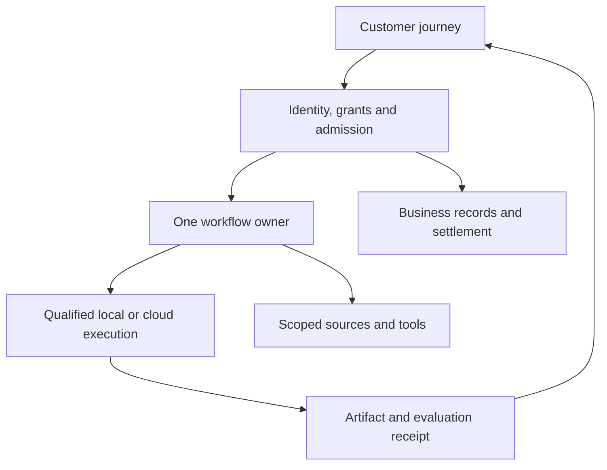

# Architecture boundaries

Reference topology. The owner table below selects the actual implementation.

| Layer | Selected owner | Status | Reason | Fallback |
| --- | --- | --- | --- | --- |
| experience | frankxai/starlightintelligence.ai: existing Mission Studio / Next.js surface | observed | Retain the established Vercel experience. Display actual availability, shared mission state and artifact-bound review. | Existing inspectable replay and local exports; no invented live status. |
| portfolio-authority | frankxai/agentic-ops: reviewed Registry | observed | Architecture identity and repository placement stay in reviewed Git. Revise the stale Notion-authority assumption in draft #476. | Read-only proposal while any authority conflict remains. |
| identity-and-admission | frankxai/starlightintelligence.ai: existing identity, membership and mission ticket contracts | proposed | Authorize tenant, node, mission, tool, resource, expiry and current operation before delegation. Authenticated transport alone grants no execution. | Protected worker routes remain unavailable. |
| coordination | frankxai/Starlight-Intelligence-System: existing SwarmCoordinator / Cloudflare Durable Objects | proposed | Use durable transactional lease state and monotonically increasing generations for one current owner per canonical resource. Namespace by tenant and resource. | Contained local deterministic tests and explicit no-dispatch status. |
| workflow | frankxai/starlightintelligence.ai: mission owner; Cloudflare Workflows adapter for cross-service missions | proposed | One workflow owner records execution attempts, checkpoints and uncertain effects. SwarmCoordinator arbitrates ownership; it does not become a second workflow engine. | Pause and reconcile instead of replaying an uncertain effect. |
| execution | frankxai/Starlight-Intelligence-System: local node and cloud adapters | proposed | Local nodes connect outbound, pull approved work and hold renewable leases. Same mission identity survives a machine change; process memory does not migrate. | Wait for an eligible node. Never silently change placement, region or data classification. |
| business-and-billing | frankxai/starlightintelligence.ai: existing Supabase/Postgres contracts | observed | Keep membership, entitlements, reservations, metering and settlement in one business authority. Gateway limits are telemetry and supplemental protection. | No dispatch when reservation, region or entitlement is unknown. |
| context-and-memory | Existing SIS scoped memory sources; application-owned authorization | proposed | Compile minimal versioned context and source locators. Explicitly authorize each source; treat vector indexes and summaries as rebuildable projections. | Lexical and source-linked retrieval from the authorized repository. |
| checkpoints-and-artifacts | SIS runtime checkpoints; existing application artifact metadata owner | proposed | Propose R2 only for private non-web executor checkpoints under a reviewed workload exception. Keep hashes, manifests, rights and scoped resolution. Existing Vercel web media rules remain. | Owner-local checkpoint plus canonical artifact reference; no automatic upload. |
| secrets-and-tools | Existing Infisical/operator secret source plus product delegated connector boundary | observed | Use short-lived scoped grants where available. MCP describes tools; current server authorization enforces effects. | Fail closed for missing or revoked connector authorization. |
| models | Existing application AI SDK/Gateway route owner; optional evaluated Cloudflare adapter | observed | Preserve the accepted default gateway. Qualify Workers AI or Cloudflare AI Gateway per workload without stacking independent budget authorities. | Known approved model route or pause; consumer plan allowances are not resale API capacity. |
| evaluation-and-distribution | SIS tests, GitHub review and existing Starlight release journey | proposed | Measure accepted mission completion, stale-writer rejection, intervention time and complete cost per accepted output. Export source and evidence. | Local-only result explicitly labeled unqualified for hosted use. |
