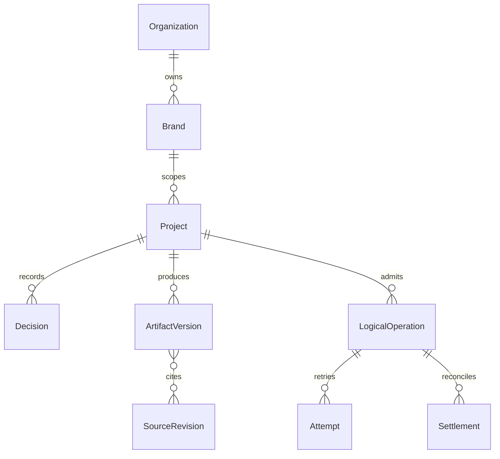

# Data and authority

Logical mapping only. Extend the owning repository's migrations and schemas.

Keep legal entity, organization, brand, tenant, product, environment and provider account distinct. Composite foreign keys and server authorization must enforce scope. Retain original artifact revisions and source authority. Usage/settlement is append-only under existing platform contracts. A graph or chat summary is a projection. Specify retention, export, deletion and restore in the owning application before hosted admission.
