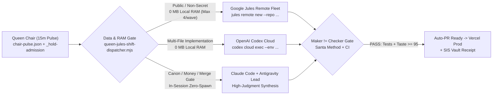

# Starlight Queen · 8-Hour Autonomous AI Corporation & Jules Swarm Masterplan (2026-10-18)

> **Visual War Room (Interactive HTML5)**: `C:\Users\frank\starlight\command-center\starlight-queen-8h-swarm-war-room.html` (and `docs/cockpit/starlight-queen-8h-swarm-war-room.html`)
> **Executable Shift Dispatcher**: `scripts/queen-jules-shift-dispatcher.mjs` (`5/5` unit tests passing in `tests/queen-jules-shift-dispatcher.test.mjs`)

---

## 1. Brutally Honest Status & Post-Mortem: Why the Previous Pass Fell Short of a True 8-Hour Shift

A top-tier engineering shift at Anthropic, Cursor/Anysphere, Linear, Vercel, or Stripe does not stop at opening Draft PRs or wiring route metadata—it closes the loop all the way to **merged production code, verified downloadable customer deliverables, and unblocked background cloud workers**.

### 1.1 Exact Scoreboard: What Is Done vs. What Was Missed

| Area | What Is Verified Done Today | What Was Missed & Why It Fell Short | Exact Fix in This 8-Hour Shift Plan |
| :--- | :--- | :--- | :--- |
| **1. 6-PR Foundation Stack** | All 6 PRs (`SIS #451`, `agentic-ops #275`, `agentic-ops-hub #362`, `starlight-command-center #80`, `starlight-estate #54`, `frankx.ai #1067`) are pushed in isolated worktrees; `#362`, `#80`, `#54`, `#1067` are **100% GREEN** on GitHub CI. | Left in `DRAFT` state instead of promoting green PRs to ready and completing the final merge cycle. | **Wave 1 (`W1-C02`)**: Promote & merge the validated green PRs in dependency order. |
| **2. Digital Product Funnel (`$1` / `$7` / `$27` / `$47` / `$97` / `$497`)** | `normalizeProductRecord()` in `lib/products.ts`, 1:1 consulting removed from `founders-circle-guild`, and `$1`/`$7`/`$27` Stripe checkout prices wired in `app/api/checkout/route.ts` (`PR #1067` all 6 CI checks + Vercel Preview green). | Added checkout metadata for `reality-md-starter-pack` ($1) and `suno-power-pack-25` ($7), but **did not build the actual downloadable starter kit files** under `public/products/` or a zero-env preview drawer. | **Wave 2 (`W2-C06`, `W2-C07`, `W2-C08`)**: Build and verify the real downloadable starter bundles + interactive preview drawers via Codex Cloud & Google Jules. |
| **3. Queen Loop & 18 Held Inbox Cards** | `queen-chair.mjs` and `dispatch-routing.json` exist; `jules` CLI is installed at `C:\Users\frank\AppData\Roaming\npm\jules.cmd`. | At `15:34 UTC`, laptop free RAM dropped to **`1,911 MB`** (`< 4,096 MB` floor) with `22` local processes running. `Invoke-StarlightQueenLoop.ps1` line 171 called `admitWork({ freeRamMB })` (defaulting to `kind="spawn"`) and exited at line 204—leaving **18 cards stuck in `queen/inbox/_hold-admission`** instead of routing clean-tree cards to **zero-local-RAM Google Jules (`kind="jules"`) and Codex Cloud**! | **Wave 1 (`W1-C01`, `W1-C03`, `W1-C04`, `W1-C05`)**: Patch the RAM-bypass router (`scripts/queen-jules-shift-dispatcher.mjs`) so `freeRamMB < 4096` only blocks heavy local CLI spawns while immediately dispatching up to 4 concurrent Google Jules remote workers + Codex Cloud tasks. |
| **4. 10-Org GitHub Governance** | `9/9` active `<Org>/.github` repositories synced live on GitHub with `CODEOWNERS` + `AGENTS.md`; `Eval-50` at `50/50 (100%)`; Estate Doctor at `20/20 PASS`. | Flagship OSS repositories (`claude-skills-library`, `arcanea-agent-skills`, `mcp-doctor`, `awesome-agent-operating-systems`) still need automated OSS release/badge/quickstart auditing across the 10 Orgs. | **Wave 3 (`W3-C13`)**: Dispatch Jules remote worker to add `--audit-oss` across flagship OSS repos. |

---

## 2. Architecture: How the Queen + Modern AI Agent Corporation Executes an 8-Hour Shift

Top-tier AI engineering organizations operate on **four non-negotiable mechanics**:
1. **Zero-Local-RAM Cloud Bursting**: Never let a developer laptop's RAM ceiling stall throughput. When local free RAM drops below `4,096 MB`, local spawns pause, and work automatically overflows to **Google Jules Remote VMs (`jules remote new`, 0 MB local RAM, up to 4 in flight)** and **OpenAI Codex Cloud Sandboxes (`codex cloud exec`, 0 MB local RAM)**.
2. **Strict Data-Classification Guard (`forbiddenFreeData`)**: Per `ops/model-arena/kb/dispatch-routing.json`, any card touching `secret`, `money`, `vault`, `identity`, or `private-canon` is **hard-blocked** from free/external lanes (`jules`, `kilo-auto/free`, `opencode-zen`) and routed strictly to the authenticated **Claude Code / Antigravity Lead Pod**.
3. **Adversarial Maker != Checker Convergence (`checkerRule: "different-provider-than-maker"`)**:
   - **Google Jules (Gemini Cloud VM)** writes PR $\rightarrow$ **Claude Code / Codex Review** verifies.
   - **Codex Cloud (OpenAI)** writes PR $\rightarrow$ **Claude Code** verifies taste & contracts.
   - **Claude Code / Antigravity** writes PR $\rightarrow$ **Grok 4.5 / Codex Review** verifies.
4. **Evidence-Only Card Closure (`DONE-CONDITION`)**: A prompt stamp is never a finished card (`queen-heal.mjs`). Every card must emit a test/build receipt, CI status, and git commit SHA.

---

## 3. The 5 Corporate Pillars: Story, Foundations, Tech, Pipelines & Products

### Pillar 1 · Brand Story & Narrative Coherence (`CCO · Claude Opus/Sonnet`)
Unify the four customer-facing doors so builders immediately understand where they are, what they can build, and how the ecosystem connects—using sentence-case labels and zero generated prestige slop (`.starlight/voice/context.md`):
- **`frankx.ai` (The AI Architect & Builder Hub)**: Flagship articles, Compute Atlas, Vibe OS Suno Lab, and the self-serve digital product store (`$1` to `$497`).
- **`gencreator.ai` (The GenCreator Methodology)**: Open `reality.md` standard, creator-to-company blueprints, and multi-harness skills.
- **`arcanea.ai` (The Creative Mythos & World)**: Ten Gates progression, Luminor companions, and interactive creative worlds (`CANON_LOCKED.md` strictly read-only).
- **`starlightintelligence.ai` (The Sovereign Substrate & Enterprise OS)**: SIP protocol, 6-vault hybrid SQLite/JSONL memory engine, and Queen multi-agent governance.

### Pillar 2 · Foundations & Governance (`CSO · Antigravity + Claude Lead`)
- Promote and merge the 6 validated PRs (`#362`, `#80`, `#54`, `#275`, `#451`, `#1067`).
- Keep `TRUTH.md`, `OBJECTIVES.md`, `SYSTEM.md`, `WORKSPACE_MAP.md`, and `reality.md` 100% synchronized so no agent ever reads stale repo counts or retired consulting offers.

### Pillar 3 · Core Tech & Hybrid Queen/Jules Routing (`CAEO · Queen + Jules + Codex Cloud`)
- Upgrade `Invoke-StarlightQueenLoop.ps1` and `queen-steer.mjs` via `scripts/queen-jules-shift-dispatcher.mjs` so low laptop RAM (`< 4096 MB`) never halts cloud/Jules dispatch.
- Drain the 18 held cards in `C:\Users\frank\starlight\queen\inbox\_hold-admission` (`compute-atlas-data-gaps`, `compute-atlas-planner-widget`, `compute-guide-publish-gates`, `pp-workload-report`, etc.).
- Surface live Jules in-flight & `_hold-admission` drain telemetry inside the port `4321` Observatory (`Starlight-Intelligence/starlight-command-center`).

### Pillar 4 · End-to-End Autonomous Production Pipelines (`CCO + CGO + CPO`)
1. **Content Factory Pipeline**: `monday-intel` research packet $\rightarrow$ MDX draft $\rightarrow$ Visual Intelligence System (`VIS`) image audit $\rightarrow$ X/LinkedIn multi-thread packet.
2. **Vibe OS Music & Video Pipeline**: Suno v4 catalog row (`mv-ingest`) $\rightarrow$ schema & prompt lineage validator $\rightarrow$ Spotify Canvas (`mv-canvas`) & audio-reactive visualizer spec (`mv-visualizer`).
3. **10-Org OSS & Package Release Pipeline**: Automated `--audit-oss` verification across `claude-skills-library`, `arcanea-agent-skills`, `mcp-doctor`, and `awesome-agent-operating-systems`.
4. **Continuous Eval-50 & FinOps Sentinel**: 2h / 12h / 7d automated verification keeping Eval-50 at `100%` and monthly spend locked within the `$274/mo` flat subscription envelope.

### Pillar 5 · Self-Serve Digital Product Factory (`CPO · Codex Cloud + Jules + Claude Lead`)
Every product tier on `frankx.ai` operates 100% self-serve (`0%` 1:1 consulting):
- **Free**: `reality.md` open spec, `mcp-doctor`, `claude-skills-library`, AI Architect Newsletter.
- **`$1` · `reality.md` Starter Pack (`/products/reality-md-starter-pack`)**: Real downloadable bundle (`public/products/reality-md-starter-pack/`) with annotated `reality.md` template, 5-invariant checklist, `AGENTS.md` starter, and interactive preview drawer.
- **`$7` · Suno Power Pack 25 (`/products/suno-power-pack-25`)**: Real downloadable bundle (`public/products/suno-power-pack-25/`) with 25 studio-tested Suno v4 metatag prompts, lyric architecture blueprint, and commercial checklist.
- **`$27` · Complete Suno Prompt Pack (`/products/suno-prompt-pack`)**: Full 200+ prompt library (`2700c` aligned across catalog and checkout).
- **`$47` · ACOS Creator Kit (`/products/acos-creator-kit`)** & **`$97` · Agentic Developer Kit (`/products/agentic-developer-kit`)**.
- **`$497` · Founders Circle Guild (`/products/founders-circle-guild`)**: 100% asynchronous vault releases, private repo drops, and async guild community.

---

## 4. The 8-Hour Shift Execution Schedule (4 Waves × 2 Hours = 20 Cards)

| Card ID | Wave & Hours | Pillar & Division | Task Summary | Target Repo | Assigned Worker | Independent Checker |
| :--- | :--- | :--- | :--- | :--- | :--- | :--- |
| **`W1-C01`** | Wave 1 (`0–2h`) | `FOUNDATIONS` · CAEO | Patch Queen Loop RAM-Bypass for Zero-RAM Cloud & Jules Steering | `frankxai/starlight-estate` | `antigravity-pod` | `codex-review` |
| **`W1-C02`** | Wave 1 (`0–2h`) | `FOUNDATIONS` · CSO | Promote & Merge Ready Foundation PRs (`#362`, `#80`, `#54`, `#275`, `#451`, `#1067`) | 6-Repo Stack | `claude-code-lead` | `grok-local` |
| **`W1-C03`** | Wave 1 (`0–2h`) | `TECH` · CAEO | Drain Held Compute Atlas Cards via Google Jules Remote Worker #1 | `frankxai/frankx.ai-vercel-website` | **`jules`** (0 MB RAM) | `claude-code-lead` |
| **`W1-C04`** | Wave 1 (`0–2h`) | `TECH` · CAEO | Drain Compute Guide Publish Gates via Google Jules Remote Worker #2 | `frankxai/frankx.ai-vercel-website` | **`jules`** (0 MB RAM) | `codex-review` |
| **`W1-C05`** | Wave 1 (`0–2h`) | `TECH` · CFO | Reclaim Zombie Local Processes & Restore `>= 4,096 MB` Free RAM | `C:/Users/frank/starlight` | `antigravity-pod` | `codex-review` |
| **`W2-C06`** | Wave 2 (`2–4h`) | `PRODUCTS` · CPO | Ship `$1` `reality.md` Starter Pack Downloadable Bundle & Preview Drawer | `frankxai/frankx.ai-vercel-website` | **`codex-cloud`** (0 MB RAM) | `claude-code-lead` |
| **`W2-C07`** | Wave 2 (`2–4h`) | `PRODUCTS` · CPO | Ship `$7` Suno Power Pack 25 Downloadable Prompt Matrix & Preview | `frankxai/frankx.ai-vercel-website` | **`jules`** (0 MB RAM) | `claude-code-lead` |
| **`W2-C08`** | Wave 2 (`2–4h`) | `PRODUCTS` · CPO | Zero-Env-Var Graceful Checkout & Instant Delivery Fallback | `frankxai/frankx.ai-vercel-website` | `claude-code-lead` | `codex-review` |
| **`W2-C09`** | Wave 2 (`2–4h`) | `STORY` · CCO | 4-Brand Narrative Bridge: FrankX $\rightarrow$ GenCreator $\rightarrow$ Arcanea $\rightarrow$ Starlight | `frankxai/frankx.ai-vercel-website` | `claude-code-lead` | `grok-local` |
| **`W2-C10`** | Wave 2 (`2–4h`) | `STORY` · CCO | Arcanea Gate Progression Onboarding & A11y Polish via Jules #3 | `frankxai/arcanea-ai-app` | **`jules`** (0 MB RAM) | `claude-code-lead` |
| **`W3-C11`** | Wave 3 (`4–6h`) | `PIPELINES` · CCO | Autonomous Content Engine Pipeline: Intel $\rightarrow$ MDX $\rightarrow$ VIS QA $\rightarrow$ Social | `frankxai/frankx.ai-vercel-website` | **`codex-cloud`** (0 MB RAM) | `claude-code-lead` |
| **`W3-C12`** | Wave 3 (`4–6h`) | `PIPELINES` · CCO | Vibe OS Music & Video Factory: Suno Catalog Schema & Canvas Validator | `frankxai/frankx.ai-vercel-website` | **`jules`** (0 MB RAM) | `codex-review` |
| **`W3-C13`** | Wave 3 (`4–6h`) | `PIPELINES` · CGO | Multi-Org OSS Showcase & README/Badge Audit across 10 GitHub Orgs | `frankxai/Starlight-Intelligence-System` | **`jules`** (0 MB RAM) | `claude-code-lead` |
| **`W3-C14`** | Wave 3 (`4–6h`) | `PIPELINES` · CPO | Observatory Live Telemetry: Jules Queue + Hold-Admission Drain Panel | `Starlight-Intelligence/starlight-command-center` | **`jules`** (0 MB RAM) | `codex-review` |
| **`W3-C15`** | Wave 3 (`4–6h`) | `TECH` · CAEO | GenCreator.ai & StarlightIntelligence.ai Cross-Domain Funnel Telemetry | `frankxai/gencreator.ai` | **`codex-cloud`** (0 MB RAM) | `claude-code-lead` |
| **`W4-C16`** | Wave 4 (`6–8h`) | `TECH` · CSO | Run Full Eval-50 Benchmark, 135 SIS Symmetry Tests & 20-Check Doctor | `frankxai/Starlight-Intelligence-System` | `antigravity-pod` | `grok-local` |
| **`W4-C17`** | Wave 4 (`6–8h`) | `PIPELINES` · CFO | Multi-Harness Token & Cloud Cost Ledger Reconciliation (`$274/mo` Guard) | `frankxai/agentic-ops` | **`codex-cloud`** (0 MB RAM) | `claude-code-lead` |
| **`W4-C18`** | Wave 4 (`6–8h`) | `STORY` · CCO | Santa Method Crown Gate Visual & Copy Audit Across All Updated Surfaces | `frankxai/frankx.ai-vercel-website` | `claude-code-lead` | `grok-local` |
| **`W4-C19`** | Wave 4 (`6–8h`) | `FOUNDATIONS` · CSO | Sync Live Memory Vaults (Strategic, Technical, Operational) & SIP Receipt | `frankxai/Starlight-Intelligence-System` | `antigravity-pod` | `claude-code-lead` |
| **`W4-C20`** | Wave 4 (`6–8h`) | `FOUNDATIONS` · CAEO | Write Canonical Estate Handover in `agentic-ops-hub` & Arm 12h/7d Daemons | `frankxai/agentic-ops-hub` | `antigravity-pod` | `codex-review` |

---

## 5. Approval & Launch Protocol

Once you approve this architecture and War Room:
1. We immediately execute **Wave 1 (`W1-C01` – `W1-C05`)**: patching the Queen RAM-bypass, promoting the validated PR stack, and firing the first **Google Jules** remote sessions (`jules remote new`) to drain `_hold-admission`.
2. We launch **Wave 2 (`W2-C06` – `W2-C10`)** in parallel across subagents + Jules to build and ship the downloadable `$1` (`reality-md-starter-pack`) and `$7` (`suno-power-pack-25`) starter bundles, zero-env checkout preview, and 4-brand narrative bridge.
3. We run **Waves 3 & 4 (`W3-C11` – `W4-C20`)** through full Santa Gate (`Maker != Checker`) verification, Eval-50 (`50/50`), and final handover in `agentic-ops-hub`.

---
Built on SIP · Starlight Intelligence Protocol
