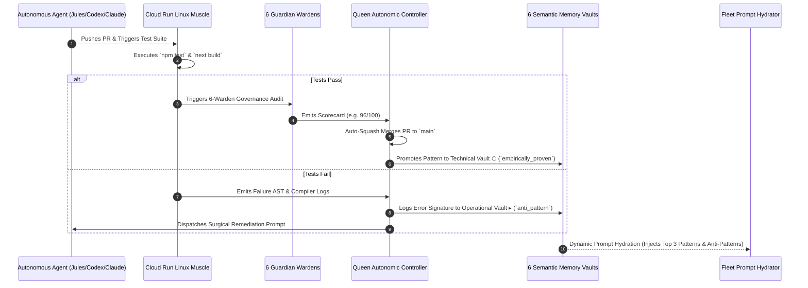

# Starlight Sovereign Startup & Swarm Operating System (OS)

> **Document Type:** Master Systems Architecture & Execution Blueprint  
> **Status:** Canonical Working Specification  
> **Attestation:** Built on SIP v1.1.1 — Sovereign Substrate  
> **Target Scale:** 80+ Local Repositories, 144 Registered Agents, Multi-Brand Federation, 24/7 Autonomous Operations  
> **Mindset:** Abundance, Sovereignty, High Intellect, Purpose-Driven Velocity  

---

## 1. Executive Vision: The Abundance Paradigm for Modern Startups

Most startups operate from an architecture of **scarcity**:
* They throttle their AI usage out of fear of API bills.
* They wait on manual code reviews and slow GitHub Actions queues.
* Their agents operate as isolated, amnesiac chat windows that re-invent solutions and repeat identical mistakes.
* They let cloud vendors lock them into proprietary walled gardens with fragile pricing tiers.

The **Starlight Sovereign Startup Operating System** operates from **abundance**:
1. **Unbounded Compute & Execution:** We decouple intelligence from platform constraints. By deploying scale-to-zero serverless runners (Google Cloud Run Jobs), sub-15ms edge routing (Cloudflare Workers & Durable Objects), and zero-cost local cockpits, we execute hundreds of tasks daily without financial anxiety or artificial speed limits.
2. **The Self-Compounding Hive Mind:** Every single pull request, test pass, compiler error, and brand design decision feeds directly into our 6 Semantic Memory Vaults. The swarm becomes measurably smarter every single day.
3. **The Multi-Brand Federation:** A single sovereign core (`Starlight Intelligence System`) powers four autonomous brand fleets—**FrankX**, **Arcanea**, **Starlight Enterprise**, and **Agentic Income**—delivering high-margin products, world-class media, and verified enterprise trust.
4. **Sovereignty First:** All data, credentials, and memory vaults remain encrypted (AES-256-GCM) under Frank’s direct ownership. Cloud providers are treated as swappable execution commodities, never masters.

### 1.1 Frontier Multi-Agent Leverage & Abundance Mechanics

To transcend standard linear agent workflows and achieve true 100x leverage, the architecture implements four frontier mechanics:

1. **Speculative Branching Execution (MCTS Code Synthesis):** High-entropy architectural and refactoring tasks do not execute sequentially. The orchestrator spawns 3–5 parallel implementation hypotheses across lightweight Cloud Run / subagent threads. Candidate branches run concurrently against unit and Sentinel suites; the Pareto-optimal patch (minimal AST diff, highest test score, lowest latency impact) is selected, and discarded branches are pruned instantly.
2. **Multi-Agent Adversarial Debate Tournaments:** For non-reversible architectural decisions, schema migrations, and high-stakes commercial commitments, single-model consensus is explicitly prohibited. We execute structured 2-round adversarial debates: **Proponent (Architect)** vs. **Red Team (Sentinel/Skeptic)**, evaluated by **Judge (Prime/Model Council)** against objective utility rubrics before committing to Strategic or Horizon vaults.
3. **Autonomous Synthetic Gym & Self-Generating Evals:** Software velocity collapses when tests are manual. Alongside every feature patch, agents generate mutation tests, fuzz payloads, and LLM-as-a-judge regression rubrics, converting every bug and edge case into a permanent sovereign eval benchmark.
4. **Heterogeneous Cognitive Tiering & Context Caching:** 85% of high-volume tasks (AST validation, linting, formatting, preliminary triage) route to ultra-fast, sub-cent models (Gemini 2.5 Flash, Grok 3 mini). Frontier reasoning models (Gemini 2.5 Pro, Claude 3.7 Thinking, o3) are reserved for system-level planning, synthesis, and debate tournaments. Long-lived system contexts and repo maps leverage context caching for up to 75% inference cost reduction.

---

## 2. Poly-Cloud Architecture: The Unified Sovereign Stack

```mermaid
flowchart TD
    subgraph Edge ["1. Edge Nervous System (Cloudflare)"]
        CF_Worker["Cloudflare Webhook Ingress (<15ms)"]
        CF_DO["Durable Objects (Swarm Blackboard & Locks)"]
        CF_Queue["Cloudflare Event Queue (Zero-Drop Buffer)"]
        CF_Worker --> CF_DO
        CF_Worker --> CF_Queue
    end

    subgraph Muscle ["2. Execution Muscle (Google Cloud Run / VPS)"]
        GCR_Job["Google Cloud Run Jobs (Scale-to-Zero Linux Runner)"]
        Hetzner_Runner["Dedicated Linux Burst Runner (Hetzner 8GB NVMe)"]
        CF_Queue --> GCR_Job
        CF_Queue --> Hetzner_Runner
    end

    subgraph Cognition ["3. Cognitive Council & Review (Multi-Model)"]
        Jules["Jules Autonomous Conductor"]
        Council["Starlight Model Council (Gemini 2.5 Pro / Claude 3.7 / o3)"]
        Queen["Queen Autonomic Self-Healing Loop"]
        Jules <--> Council
        Council <--> Queen
    end

    subgraph Memory ["4. Sovereign Memory Substrate (Starlight Vaults)"]
        Memory_Gateway["Starlight Memory Gateway (src/gateway/)"]
        Vaults["6 Semantic Vaults (Strategic, Tech, Creative, Ops, Wisdom, Horizon)"]
        Memory_Gateway <--> Vaults
        Queen <--> Memory_Gateway
    end

    subgraph Cockpit ["5. Sovereign Cockpit (2 Laptops + P2P Mesh)"]
        Laptop1["Laptop 1 (Studio Cockpit)"]
        Laptop2["Laptop 2 (Travel Cockpit)"]
        Laptop1 <-->|Syncthing / Encrypted P2P| Laptop2
        Laptop1 <--> Memory_Gateway
        Laptop2 <--> Memory_Gateway
```

### 2.1 Distributed Execution Resilience & Split-Brain Mitigation Matrix

Operating an autonomous swarm across Cloudflare edge, Cloud Run serverless jobs, Vercel web hosting, and a dual-laptop local cockpit introduces distributed systems failure modes. We enforce explicit mitigation invariants:

| Distributed Failure Mode | Vulnerability Mechanism | Sovereign Mitigation Pattern | Invariant Guarantee |
| :--- | :--- | :--- | :--- |
| **P2P Split-Brain & Git Corruption** | Concurrent edits across Laptop 1 and Laptop 2 via Syncthing corrupt `.git/index` or produce unmergeable `.sync-conflict` files. | **Strict Boundary & Lease Decoupling:**<br>1. Syncthing syncs *only* non-git scratch directories and encrypted vault mirrors; live `.git` repositories are explicitly `.stignore` excluded.<br>2. Cloudflare Durable Objects enforce **Distributed Lease Locks** (`/lock/repo/:name`, 60s TTL, auto-heartbeat) prior to any agent write.<br>3. Git remotes on GitHub remain the sole serialized transactional commit ledger via isolated branch convention (`agent/<harness>/<scope>`). | Zero corrupted worktrees; single-writer guarantee per repo. |
| **Cloud Run Ephemeral State Loss** | Scale-to-zero container terminates, times out, or gets evicted before test results or PR commits push to upstream. | **Two-Phase Staging Commit (2PC):**<br>1. Runners stream execution logs in real time to Cloudflare R2 / Durable Object webhooks.<br>2. Runners push draft commits directly to git remote *before* issuing completion signal.<br>3. Durable Object ACKs and marks task complete only after verifying the git commit SHA via GitHub API. | Zero silent task dropouts; deterministic state recovery. |
| **Ingress Webhook Duplication & Storms** | GitHub/Stripe webhook retries cause duplicated task executions or runner saturation. | **Sliding-Window Idempotency Ledger:**<br>Cloudflare Durable Objects maintain an in-memory 24h Bloom filter + key-value store of `x-github-delivery` and Stripe event IDs. Duplicates ACK with `200 OK` immediately without queuing. | Exactly-once task dispatch. |
| **Vercel Preview / Production Build Race** | Multiple PRs merging in rapid succession saturate Vercel build queues or trigger deployment races. | **Batch Merge Trains:**<br>Queen queues green PRs into 15-minute rollup batches during peak activity, verifying the composite build before triggering a single production deploy. | No deployment thrashing; zero queue lockups. |

---

## 3. The 4 Autonomous Brand Teams & Business Engines

Each brand operates with an autonomous crew consisting of a **Domain Queen**, a **Revenue Scout**, a **Content/Polish Warden**, and an **Execution Engineer**:

### Brand 1: FrankX (`frankx.ai`, Advisory, Creator Media, Masterclasses)
* **Mission:** Establish Frank as the global AI Systems Architect, scale high-ticket enterprise advisory ($15k–$50k retainers), and publish world-class high-intellect YouTube & newsletter media.
* **Proactive Daily Swarm & Commercial Closed-Loop:**
  * **FrankX Queen:** Orchestrates 7-day thematic content arcs, enforces editorial quality, approves high-stakes communications.
  * **Frontier Signal Analyst & Vibe Scout:** Scans arXiv, frontier lab drops (Google, Anthropic, OpenAI), and AI engineering discourse 24/7; generates structured video hooks and technical breakdowns.
  * **Multi-Format Content Cascade:** Converts operator voice memos into a coordinated weekly cascade: 1 deep architectural essay, 1 cinematic technical YouTube script with storyboard, and 5 technical LinkedIn/X breakdowns adhering to Frank DNA voice.
  * **Enterprise Inbound Intelligence Scout:** Monitors technical engagement across public posts, identifies verified engineering leaders/founders, generates pre-call technical dossiers, and routes high-intent inbound inquiries directly to advisory scheduling.
* **Verifiable Metrics:**
  * Qualified Inbound Pipeline: $\ge 4$ pre-vetted enterprise advisory briefs/month.
  * YouTube Audience Growth & Retention: $\ge 45\%$ average percentage viewed on long-form technical deep-dives.
  * Newsletter Conversion Rate: $\ge 8.5\%$ visitor-to-subscriber conversion on high-intent landers.

### Brand 2: Arcanea (`arcanea.ai`, Creative Studio, AnimeLegends, Mythic IP)
* **Mission:** Build the world's most immersive mythic creative universe, generative gaming/entertainment IP, and high-margin AI studio SaaS tools.
* **Proactive Daily Swarm & Commercial Closed-Loop:**
  * **Arcanea Queen:** Enforces mythic lore consistency, world-building canon locks, and creative narrative arcs.
  * **Visual & Sound Production Engine:** Generates 20+ pristine visual assets daily (Flux/Midjourney/Higgsfield) and bespoke soundtrack cues (Suno Prompt Architect), enforcing character design consistency.
  * **Content-to-Product Flywheel:** Compiles assets into interactive lore cards and renders high-velocity short-form reels (TikTok, YouTube Shorts, Instagram); each piece embeds direct frictionless sign-up paths into the Arcanea AI Studio.
  * **Studio App Polish Warden:** Audits `arcanea-ai-app` continuously; validates 60fps animations, mobile touch targets (min 48px), dark-mode tokens, and canvas interactions.
* **Verifiable Metrics:**
  * Active Studio Growth: Compounding paid Studio subscriptions and token pack purchases.
  * Free-to-Paid Conversion Rate: $\ge 4.2\%$ of active canvas users upgrading to Pro/Creator tiers.
  * Organic Reach Velocity: $\ge 500\text{k}$ monthly short-form impressions with $<\$0.35$ effective CPA.
  * User Engagement: $>18$ minutes average daily session duration on studio canvas.

### Brand 3: Starlight Intelligence Systems (`starlightintelligence.ai`, Substrate, SIP)
* **Mission:** Provide the world’s leading sovereign persistent memory and agent orchestration protocol for high-performance builders, AI native teams, and enterprises.
* **Proactive Daily Swarm & Commercial Closed-Loop:**
  * **Starlight Queen & Architect:** Governs the 144-agent registry, verifies SIP protocol attestation, and audits cross-repo architectural symmetry.
  * **Jules Autonomous Conductor:** Continuously monitors GitHub issues, drafts surgical code patches, executes Maker/Checker reviews, and auto-merges green PRs.
  * **Open-Source Attestation Billboard:** Merges code carrying `Built on SIP` attestation across public repositories, demonstrating zero regression and persistent multi-agent memory.
  * **Enterprise Memory PoC Generator:** Generates automated codebase memory-loss audits for prospective B2B clients, demonstrating how Starlight Vaults eliminate amnesia and cut token waste by up to 70%.
  * **Sentinel Security Guardian:** Performs continuous AST taint analysis, credential leakage auditing, and dependency vulnerability scanning across all 80+ repositories.
* **Verifiable Metrics:**
  * Production PR Velocity: 30+ verified PRs/day with 0 security regressions and 100% test pass rate.
  * Enterprise Sovereign Deployments: $\ge 2$ enterprise private memory cluster contracts ($25k–$100k ACV) closed or piloted per quarter.
  * Substrate Integrity: 100% Sentinel pass rate; zero credential leaks.

### Brand 4: Agentic Income & Business OS (`agenticincome`, `retreat-os`, Commerce Engine)
* **Mission:** Maximize cashflow velocity through automated software sales, affiliate control planes, digital products, and commercial licensing rails.
* **Proactive Daily Swarm & Commercial Closed-Loop:**
  * **Business Queen:** Monitors unit economics, gross margins, payment processor health, and recurring cashflow.
  * **24/7 Affiliate Health Engine:** Hourly link verification across all partner rails; immediately catches broken redirects, altered commission tiers, or expired partner programs.
  * **Programmatic High-Intent SEO Sentry:** Generates and maintains comparison matrices ("Tool A vs Tool B for AI Builders") and software review hubs with Schema.org JSON-LD structured data.
  * **Billing & Self-Healing Dunning Reconciler:** Validates Stripe webhook event delivery, automates software license key issuance, and triggers proactive dunning retention sequences before subscriptions lapse.
* **Verifiable Metrics:**
  * Net Monthly Recurring Revenue (MRR) and gross margin ($\ge 88\%$).
  * Zero Affiliate Leakage: $0.00$ lost to dead tracking links or broken redirects.
  * Dunning Recovery Yield: $\ge 38\%$ of failed subscription renewals recovered automatically.
  * Checkout Conversion Rate: $\ge 3.8\%$ on digital products and software tools.

---

## 4. The 6 Production Guardian Wardens

Every pull request across all repositories must pass the **Starlight 6-Warden Audit** before merging:

| Warden | Scope & Verification Checks | Failure Response |
| :--- | :--- | :--- |
| **1. Security Sentinel** | • Scans diffs for API keys, tokens, `.env` files, and credentials<br>• Runs AST taint analysis on user inputs<br>• Checks npm/pnpm audit for high/critical CVEs | **Hard Quarantine**<br>Merge blocked; alert sent to operator. |
| **2. Brand & Anti-Slop** | • Enforces brand voice rules (`brand-packs/sis/COPY.md`)<br>• Rejects generic AI clichés ("streamline", "optimize", "cutting-edge")<br>• Enforces sentence case on buttons, badges, and headers | **Auto-Humanize**<br>Rewrites copy to brand register. |
| **3. Web Excellence** | • Audits Core Web Vitals (LCP < 1.2s, CLS < 0.05, INP < 100ms)<br>• Enforces WCAG AA contrast and 48px touch targets<br>• Verifies `prefers-reduced-motion` compliance | **Quarantine**<br>Generates responsive CSS patch. |
| **4. SEO & Knowledge Graph** | • Verifies JSON-LD Schema.org graphs (Article, Organization, SoftwareApplication)<br>• Audits canonical tags, OpenGraph cards, and Twitter meta<br>• Ensures semantic HTML (`<main>`, `<article>`, `<nav>`) | **Auto-Inject**<br>Generates missing meta tags. |
| **5. Maker/Checker Architect** | • Enforces React 19 Server Actions & Server Component patterns<br>• Audits Lucide icon tree-shaking and Tailwind v4 `@theme`<br>• Enforces dead code isolation and strict TypeScript types | **Scorecard Gate**<br>Requires score $\ge 85/100$ to merge. |
| **6. SIP Attestation** | • Validates presence of `Built on SIP` attestation footer<br>• Verifies commit hash integrity and canon locks<br>• Checks branch protection and git author attestation | **Hard Gate**<br>Refuses untrusted commits. |

---

## 5. The Closed-Loop Intelligence Feedback Nervous System



### 5.1 Mathematically Optimal Context Engineering & SAGE Memory Pipeline

Uncontrolled memory injection causes attention dilution, prompt bloat, and "lost-in-the-middle" reasoning degradation. The Starlight Memory Gateway enforces strict mathematical context invariants:

1. **Canonical Error Fingerprinting:** Compilers and test runners never dump raw 500-line stack traces into prompts or vaults. The engine extracts the normalized canonical tuple:
   $$\text{Signature} = \langle \text{ErrorClass}, \text{SymbolPath}, \Delta\text{AST}_{\text{minimal}}, \text{ReproSnippet}_{\le 5\text{ lines}} \rangle$$
2. **Empirical Proving Ground (Sandbox Gate):** No pattern enters Technical Vault ⬡ (`empirically_proven`) without isolated sandboxed execution. Accidental workarounds, unverified fixes, and non-deterministic passes are quarantined in `memory/vaults/operational/quarantine-log.jsonl`.
3. **Reciprocal Rank Fusion (RRF) Memory Retrieval:** Context hydration avoids naive cosine search by blending sparse symbol BM25 with dense semantic intent via the Starlight Memory Gateway:
   $$\text{RRF}(d) = \sum_{m \in \{\text{BM25}, \text{Dense}\}} \frac{1}{k + \text{rank}_m(d)} \quad (k=60)$$
4. **Hard Token Budget ($\le 400$ Tokens Injected Context):** Hydration injects strictly bounded, high-density invariant tuples into the system prompt:
   `[INVARIANT: <Repo/Framework> | <Trigger Condition> | <Required Pattern> | <Strict Anti-Pattern>]`
   Narrative prose, redundant instructions, and speculative context are mathematically pruned.
5. **Temporal Decay & Contradiction Resolution:** Vault memories decay according to a 90-day half-life:
   $$W(t) = W_0 \cdot 2^{-t / 90}$$
   When a framework updates or an established pattern is invalidated by newer test runs, `sis_contradict` immediately supersedes obsolete entries.
6. **SAGE Checkpoint & Rollback Protocol:** Before any autonomous agent loop executes code mutations, SAGE captures an atomic git checkpoint. If an agent fails to achieve green tests within 3 iterations, SAGE triggers an automated rollback to the checkpoint, preventing cyclic context poisoning and hallucination death-loops.

---

## 6. Financial & Scale Economics

Calculated for an estate scaling from **1,000 to 20,000 automated tasks/month**:

| Component | 1,000 Tasks/Mo | 5,000 Tasks/Mo | 20,000 Tasks/Mo | Notes |
| :--- | :--- | :--- | :--- | :--- |
| **Cloudflare Edge Ingress & Durable Objects** | $0.00 | $0.00 | $5.00 | Included in Cloudflare Free & Standard Tiers |
| **Google Cloud Run Jobs (Scale-to-Zero)** | $0.00 | $3.50 | $16.00 | First 360,000 vCPU-seconds free every month |
| **Dedicated Hetzner Linux Burst Runner** | $7.50 | $7.50 | $12.50 | 8GB–16GB RAM, 4 vCPUs, 80GB NVMe flat rate |
| **Cognitive Inference (Gemini 2.5 Flash + Pro)** | $8.00 | $22.00 | $65.00 | Utilizes context caching for 75% prompt savings |
| **Vercel Pro (Web Hosting & Edge Previews)** | $20.00 | $20.00 | $20.00 | Flat developer team pricing |
| **Total Monthly Investment:** | **~$35.50** | **~$53.00** | **~$118.50** | **Runs an entire 144-agent enterprise 24/7** |
| **Cost per Shipped Production Task:** | **~$0.035** | **~$0.010** | **~$0.0059** | Less than a penny per shipped PR at scale |

---

## 7. Immediate 3-Phase Execution Roadmap

### Phase 1: Ingress & Auto-Merge Foundations (Today)
1. **Deploy Cloudflare Webhook Ingress Worker (`tools/fleet-ingress`):** Connect all 80+ repositories to a unified edge event queue using existing Cloudflare account (`frank.riemer97@gmail.com`).
2. **Activate Autonomous Auto-Merge in Jules Conductor:** Enable `"autoMerge": true` and `"estateSweep": true` in `tools/jules-conductor/config.json`.
3. **Wire Post-Merge & Quarantine Memory Hooks:** Automatically log winning patterns to `memory/vaults/technical/` and failure anti-patterns to `memory/vaults/operational/quarantine-log.jsonl`.

### Phase 2: Compute Muscle & Multi-Laptop Sync (This Week)
1. **Package Google Cloud Run Scale-to-Zero Runner:** Build Docker image (`ubuntu:24.04` + Node 24 + pnpm) to run Linux CI builds on demand for $0 idle.
2. **Synchronize 2-Laptop Cockpits:** Establish P2P Syncthing / Git remote sync across Laptop 1 and Laptop 2 via the Starlight Memory Gateway.
3. **Deploy Cloudflare Durable Object Swarm Blackboard:** Provide live in-memory task locking and state sharing across both laptops and cloud workers.

### Phase 3: Domain Queens & Proactive Revenue Swarms (Next 30 Days)
1. **Commission Brand Queen Profiles:** Deploy dedicated config profiles for Arcanea Queen, FrankX Queen, and Business Queen.
2. **Automate Affiliate & SEO Sentry Daemons:** Schedule daily automated health and conversion audits across `frankx.ai` and `arcanea.ai`.
3. **Activate Starlight Foundry Auto-Recompilation:** Allow recurring proven patterns to automatically compile into markdown skill packages in `skills/`.
