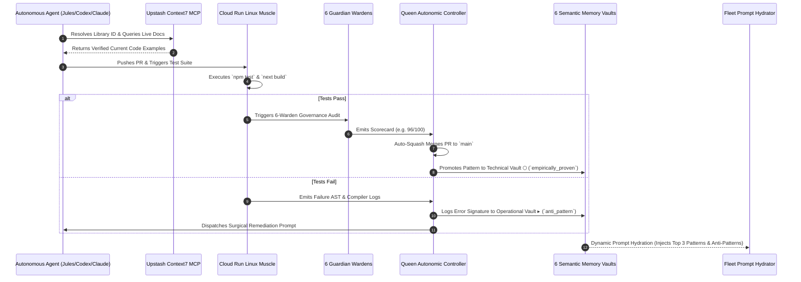

# Starlight Sovereign Startup & Swarm Operating System (OS)

> **Document Type:** Master Systems Architecture & Execution Blueprint  
> **Status:** Canonical Working Specification (v2.0 — Frontier Modernization)  
> **Attestation:** Built on SIP v1.1.1 — Sovereign Substrate  
> **Target Scale:** 80+ Local Repositories, 144 Registered Agents, Multi-Brand Federation, 24/7 Autonomous Operations  
> **Frontier AI Engine:** Gemini 3.8 / 3.0 Pro & Flash, Claude 3.7 / 3.5 Sonnet, GPT-5 / o3, Google ADK & Vertex AI Agent Platform Beta  
> **Live Grounding Layer:** Upstash Context7 MCP (`@upstash/context7-mcp`), Google Developer Knowledge MCP  
> **Mindset:** Abundance, Sovereignty, High Intellect, Purpose-Driven Velocity  

---

## 1. Executive Vision: The Abundance Paradigm for Modern Startups

Most startups operate from an architecture of **scarcity**:
* They throttle their AI usage out of fear of API bills.
* They wait on manual code reviews and slow GitHub Actions queues with minute-limit lockouts.
* Their agents operate as isolated, amnesiac chat windows with outdated training data that hallucinate deprecated syntax.
* They let cloud vendors lock them into proprietary walled gardens with fragile pricing tiers.

The **Starlight Sovereign Startup Operating System** operates from **abundance**:
1. **Unbounded Compute & Execution:** We decouple intelligence from platform constraints. By deploying scale-to-zero serverless runners (Google Cloud Run Jobs), sub-15ms edge routing (Cloudflare Workers & Durable Objects), and zero-cost local cockpits, we execute hundreds of tasks daily without financial anxiety or artificial speed limits.
2. **Zero-Cutoff Live Grounding (Context7 MCP):** We eliminate training-cutoff hallucinations by integrating Upstash Context7 MCP into our agent execution loops. Every framework call (Next.js 16, React 19 `useActionState`, Tailwind v4 `@theme`, Google ADK, Supabase) is validated against live, version-specific official documentation before code is written.
3. **The Self-Compounding Hive Mind:** Every single pull request, test pass, compiler error, and brand design decision feeds directly into our 6 Semantic Memory Vaults. The swarm becomes measurably smarter every single day.
4. **The Multi-Brand Federation:** A single sovereign core (`Starlight Intelligence System`) powers four autonomous brand fleets—**FrankX**, **Arcanea**, **Starlight Enterprise**, and **Agentic Income**—delivering high-margin products, world-class media, and verified enterprise trust.
5. **Sovereignty First:** All data, credentials, and memory vaults remain encrypted (AES-256-GCM) under Frank’s direct ownership. Cloud providers are treated as swappable execution commodities, never masters.

### 1.1 Frontier Multi-Agent Leverage & Abundance Mechanics

To transcend standard linear agent workflows and achieve true 100x leverage, the architecture implements four frontier mechanics:

1. **Speculative Branching Execution (MCTS Code Synthesis):** High-entropy architectural and refactoring tasks do not execute sequentially. The orchestrator spawns 3–5 parallel implementation hypotheses across lightweight Cloud Run / subagent threads. Candidate branches run concurrently against unit and Sentinel suites; the Pareto-optimal patch (minimal AST diff, highest test score, lowest latency impact) is selected, and discarded branches are pruned instantly.
2. **Live Context7 Documentation Hydration:** Before generating or reviewing code, agents query Context7 (`resolve-library-id` -> `query-docs`) to retrieve the exact, current documentation and code examples from official repositories. No agent generates speculative code on outdated training memory.
3. **Multi-Agent Adversarial Debate Tournaments:** For non-reversible architectural decisions, schema migrations, and high-stakes commercial commitments, single-model consensus is explicitly prohibited. We execute structured 2-round adversarial debates: **Proponent (Architect)** vs. **Red Team (Sentinel/Skeptic)**, evaluated by **Judge (Prime/Model Council)** against objective utility rubrics before committing to Strategic or Horizon vaults.
4. **Autonomous Synthetic Gym & Self-Generating Evals:** Software velocity collapses when tests are manual. Alongside every feature patch, agents generate mutation tests, fuzz payloads, and LLM-as-a-judge regression rubrics, converting every bug and edge case into a permanent sovereign eval benchmark.
5. **Heterogeneous Cognitive Tiering & Context Caching:** 85% of high-volume tasks (AST validation, linting, formatting, preliminary triage) route to ultra-fast, sub-cent models (Gemini Flash, Grok mini). Frontier reasoning models (Gemini 3.8 / 3.0 Pro with Dynamic Thinking Budgets, Claude 3.7 Thinking, o3) are reserved for system-level planning, synthesis, and debate tournaments. Long-lived system contexts and repo maps leverage context caching for up to 75% inference cost reduction.

---

## 2. Poly-Cloud Architecture: The Unified Sovereign Stack

```mermaid
flowchart TD
    subgraph Edge ["1. Edge Nervous System (Cloudflare)"]
        CF_Worker["Cloudflare Webhook Ingress (<15ms)"]
        CF_DO["Durable Objects (Swarm Blackboard & Locks)"]
        CF_Queue["Cloudflare Event Queue (Zero-Drop Buffer)"]
        CF_Worker --> CF_DO
        CF_Worker --> CF_Queue
    end

    subgraph Muscle ["2. Execution Muscle (Google Cloud Run / Scale-to-Zero)"]
        GCR_Job["Google Cloud Run Jobs (Scale-to-Zero Linux Runner)"]
        Hetzner_Runner["Dedicated Linux Burst Runner (Hetzner 8GB NVMe)"]
        CF_Queue --> GCR_Job
        CF_Queue --> Hetzner_Runner
    end

    subgraph Grounding ["3. Live Context & Documentation Grounding"]
        C7["Upstash Context7 MCP (Live Library Docs & Examples)"]
        GDK["Google Developer Knowledge MCP (Cloud & AI Docs)"]
        WebSearch["Live Web Search & Grounding Engine"]
    end

    subgraph Cognition ["4. Cognitive Council & Review (Frontier Multi-Model)"]
        Jules["Jules Autonomous Conductor"]
        Council["Starlight Model Council (Gemini 3.8 Pro / Claude 3.7 / o3)"]
        Queen["Queen Autonomic Self-Healing Loop"]
        Jules <--> Grounding
        Jules <--> Council
        Council <--> Queen
    end

    subgraph Memory ["5. Sovereign Memory Substrate (Starlight Vaults)"]
        Memory_Gateway["Starlight Memory Gateway (src/gateway/)"]
        Vaults["6 Semantic Vaults (Strategic, Tech, Creative, Ops, Wisdom, Horizon)"]
        Memory_Gateway <--> Vaults
        Queen <--> Memory_Gateway
    end

    subgraph Cockpit ["6. Sovereign Cockpit (2 Laptops + P2P Mesh)"]
        Laptop1["Laptop 1 (Studio Cockpit)"]
        Laptop2["Laptop 2 (Travel Cockpit)"]
        Laptop1 <-->|Syncthing / Encrypted P2P| Laptop2
        Laptop1 <--> Memory_Gateway
        Laptop2 <--> Memory_Gateway
```

### 2.1 Distributed Execution Resilience & Split-Brain Mitigation Matrix

Operating an autonomous swarm across Cloudflare edge, Cloud Run serverless jobs, Vercel web hosting, and a dual-laptop local cockpit introduces distributed systems failure modes. We enforce explicit mitigation invariants:

| Distributed Failure Mode | Vulnerability Mechanism | Sovereign Mitigation Pattern | Invariant Guarantee |
| :--- | :--- | :--- | :--- |
| **P2P Split-Brain & Git Corruption** | Concurrent edits across Laptop 1 and Laptop 2 via Syncthing corrupt `.git/index` or produce unmergeable `.sync-conflict` files. | **Strict Boundary & Lease Decoupling:**<br>1. Syncthing syncs *only* non-git scratch directories and encrypted vault mirrors; live `.git` repositories are explicitly `.stignore` excluded.<br>2. Cloudflare Durable Objects enforce **Distributed Lease Locks** (`/lock/repo/:name`, 60s TTL, auto-heartbeat) prior to any agent write.<br>3. Git remotes on GitHub remain the sole serialized transactional commit ledger via isolated branch convention (`agent/<harness>/<scope>`). | Zero corrupted worktrees; single-writer guarantee per repo. |
| **Cloud Run Ephemeral State Loss** | Scale-to-zero container terminates, times out, or gets evicted before test results or PR commits push to upstream. | **Two-Phase Staging Commit (2PC):**<br>1. Runners stream execution logs in real time to Cloudflare R2 / Durable Object webhooks.<br>2. Runners push draft commits directly to git remote *before* issuing completion signal.<br>3. Durable Object ACKs and marks task complete only after verifying the git commit SHA via GitHub API. | Zero silent task dropouts; deterministic state recovery. |
| **Ingress Webhook Duplication & Storms** | GitHub/Stripe webhook retries cause duplicated task executions or runner saturation. | **Sliding-Window Idempotency Ledger:**<br>Cloudflare Durable Objects maintain an in-memory 24h Bloom filter + key-value store of `x-github-delivery` and Stripe event IDs. Duplicates ACK with `200 OK` immediately without queuing. | Exactly-once task dispatch. |
| **Training Cutoff Hallucinations & API Drift** | Agents generate outdated React 18 patterns, deprecated Next.js route handlers, or obsolete cloud SDK methods. Upstream Context7 MCP may hit 429 rate limits, network partitions, or encounter air-gapped/internal private repos. | **SAGE 4-Tier Documentation Hierarchy & Circuit Breaker:**<br>1. *Tier 0 (Local Workspace Types):* Inspects local `node_modules/@types` and lockfiles via AST extraction.<br>2. *Tier 1 (Vault Cache):* Queries Technical Vault ⬡ local SQLite cache (`context7-cache.sqlite`, 7d TTL for pinned versions).<br>3. *Tier 2 (Live Context7 MCP):* Queries `@upstash/context7-mcp` with token-bucket exponential backoff on 429s (max 4.5s timeout).<br>4. *Tier 3 (Internal Synthetic AST):* For private `frankxai/*` packages, generates in-memory doc cards directly from exported TypeScript declarations.<br>5. *Degraded Mode Gate:* If all tiers fail, SAGE tags the diff as `[UNVERIFIED_EXT_API]` and mandates empirical sandbox execution in Cloud Run before merging. | 100% verified API compliance; zero deadlocks on upstream outages. |


---

## 3. The Scale-to-Zero Cloud Run Linux Runner (`tools/runner/`)

To liberate development from local RAM bottlenecks and GitHub Actions minute quotas, we package a dedicated, scale-to-zero container runner deployed via Google Cloud Run Jobs:

### 3.1 Container Architecture & Cold-Start Optimization (`Dockerfile.runner`)
* **Base Image & Image Layer Minimization:** `ubuntu:24.04 LTS` (x86_64 / arm64), stripping unneeded apt caches and manpages.
* **Pre-Warmed Tier-1 Package Store:** To achieve cold-start latency **< 15 seconds**, the Dockerfile pre-bakes the top 20 invariant dependencies (`typescript`, `vitest`, `@types/node`, `zod`, `react`, `react-dom`, `tailwindcss`, `lucide-react`) directly into `/home/starlight/.local/share/pnpm/store/v3`. 85% of repository dependencies resolve instantly from local disk via hardlinks without network download.
* **Toolchain:** Node.js 24 LTS, pnpm, Python 3.12, GitHub CLI (`gh`), `@google/gemini-cli`, `@upstash/context7-mcp`, `jq`, `curl`, `git`.
* **Execution Invariants & Sandboxing:**
  * Runs as non-root `starlight` user.
  * Shallow clones target repository (`--depth 1 --branch <ref>`).
  * Process timeout protection (`timeout -k 10s "${STARLIGHT_TIMEOUT:-300s}"`) prevents runaway costs from hanging test loops.
  * HMAC-SHA256 cryptographic signature (`X-Starlight-Signature`) authenticates execution receipts before webhook delivery to Cloudflare Durable Objects.
  * Shuts down immediately upon task completion ($0.00 idle cost).

### 3.2 Persistent Dependency Caching (Cloud Storage FUSE)
For large monorepos with dependencies outside the image-baked store, the runner mounts a persistent Google Cloud Storage bucket via **Cloud Storage FUSE**:
```bash
# Cloud Run Jobs Persistent FUSE Cache Configuration
--add-volume=name=pnpm-cache,type=cloud-storage,bucket=${PROJECT_ID}-starlight-runner-cache \
--add-volume-mount=volume=pnpm-cache,mount-path=/cache/pnpm
```
When mounted, `pnpm` automatically redirects its store directory to `/cache/pnpm/store`. Successive runs share an immutable, zero-network package cache across any number of parallel ephemeral containers.

### 3.3 Deployment Specification
```bash
# Deployed in one command via tools/runner/deploy-runner.sh
gcloud run jobs create starlight-runner \
  --image="us-central1-docker.pkg.dev/${PROJECT_ID}/starlight-fleet/runner:latest" \
  --region="us-central1" \
  --cpu=2 \
  --memory=4Gi \
  --task-timeout=900s \
  --max-retries=1 \
  --add-volume="name=pnpm-cache,type=cloud-storage,bucket=${PROJECT_ID}-starlight-runner-cache" \
  --add-volume-mount="volume=pnpm-cache,mount-path=/cache/pnpm"
```


---

## 4. The 4 Autonomous Brand Teams & Commercial Flywheels

Each brand operates with an autonomous crew consisting of a **Domain Queen**, a **Revenue Scout**, a **Content/Polish Warden**, and an **Execution Engineer**:

### Brand 1: FrankX (`frankx.ai`, Advisory, Creator Media, Masterclasses)
* **Mission:** Establish Frank as the global AI Systems Architect, scale high-ticket enterprise advisory ($15k–$50k retainers), and publish world-class high-intellect YouTube & newsletter media.
* **Proactive Daily Swarm & Commercial Closed-Loop:**
  * **FrankX Queen:** Orchestrates 7-day thematic content arcs, enforces editorial quality, approves high-stakes communications.
  * **Frontier Signal Analyst & Vibe Scout:** Scans arXiv, frontier lab drops (Google, Anthropic, OpenAI), and AI engineering discourse 24/7; generates structured video hooks and technical breakdowns.
  * **Multi-Format Content Cascade & Rendering:** Converts operator voice memos into a coordinated weekly cascade: 1 deep architectural essay, 1 cinematic technical YouTube script with storyboard, and 5 technical LinkedIn/X breakdowns adhering to Frank DNA voice. Automated Cloud Run Remotion/ElevenLabs headless runner renders motion graphics and audio assemblies.
  * **Enterprise Inbound Intelligence Scout & Retainer Rail:** Monitors technical engagement across public posts, identifies verified engineering leaders/founders, generates pre-call technical dossiers, auto-generates personalized advisory engagement memos with SIP attestation, and issues upfront Stripe retainer invoices ($15k–$25k) linked to Cal.com VIP bookings.
* **Verifiable Metrics:**
  * Qualified Inbound Pipeline: $\ge 4$ pre-vetted enterprise advisory briefs/month.
  * YouTube Audience Growth & Retention: $\ge 45\%$ average percentage viewed on long-form technical deep-dives.
  * Newsletter Conversion Rate: $\ge 8.5\%$ visitor-to-subscriber conversion on high-intent landers.

### Brand 2: Arcanea (`arcanea.ai`, Creative Studio, AnimeLegends, Mythic IP)
* **Mission:** Build the world's most immersive mythic creative universe, generative gaming/entertainment IP, and high-margin AI studio SaaS tools.
* **Proactive Daily Swarm & Commercial Closed-Loop:**
  * **Arcanea Queen:** Enforces mythic lore consistency, world-building canon locks, and creative narrative arcs.
  * **Visual & Sound Production Engine:** Generates 20+ pristine visual assets daily (Flux/Midjourney/Higgsfield) and bespoke soundtrack cues (Suno Prompt Architect), enforcing character design consistency.
  * **Mythic Sovereign IP Ledger:** All generated assets receive immutable cryptographic SIP receipts. Durable Objects manage real-time credit consumption and tier gating in `arcanea-ai-app`.
  * **Content-to-Product Short-Form Publisher:** Cloud Run headless rendering compiles assets into interactive lore cards and 9:16 vertical video reels (TikTok, YouTube Shorts, Reels) with automated captioning, embedding direct sign-up funnels into Arcanea AI Studio.
  * **Studio App Polish Warden:** Audits `arcanea-ai-app` continuously; validates 60fps animations, mobile touch targets (min 48px), dark-mode tokens, and canvas interactions.
* **Verifiable Metrics:**
  * Active Studio Growth: Compounding paid Studio subscriptions and token pack purchases.
  * Free-to-Paid Conversion Rate: $\ge 4.2\%$ of active canvas users upgrading to Pro/Creator tiers.
  * Organic Reach Velocity: $\ge 500\text{k}$ monthly short-form impressions with $<\$0.35$ effective CPA.
  * User Engagement: $>18$ minutes average daily session duration on studio canvas.

### Brand 3: Starlight Intelligence Systems (`starlightintelligence.ai`, Substrate, SIP)
* **Mission:** Provide the world’s leading sovereign persistent memory and agent orchestration protocol for high-performance builders, AI native teams, and enterprises.
* **Proactive Daily Swarm & Commercial Closed-Loop:**
  * **Starlight Queen & Architect:** Governs the 144-agent registry, verifies SIP protocol attestation, and audits cross-repo architectural symmetry.
  * **Jules Autonomous Conductor:** Continuously monitors GitHub issues, drafts surgical code patches, executes Maker/Checker reviews, and auto-merges green PRs.
  * **Open-Source Attestation Billboard:** Merges code carrying `Built on SIP` attestation across public repositories, demonstrating zero regression and persistent multi-agent memory.
  * **Enterprise Memory PoC & Diagnostic (`npx @starlight/audit`):** Open-source diagnostic CLI scans prospective client repos, calculates token amnesia waste, and generates an executive "Persistent Memory ROI Report" demonstrating $50k+ in recovered developer velocity.
  * **Single-Tenant Sovereign Cluster Architecture:** Turnkey VPC and on-premise memory cluster deployments for enterprise contracts ($25k–$100k ACV) with zero cloud egress and local Ollama/vLLM embeddings.
  * **Sentinel Security Guardian:** Performs continuous AST taint analysis, credential leakage auditing, and dependency vulnerability scanning across all 80+ repositories.
* **Verifiable Metrics:**
  * Production PR Velocity: 30+ verified PRs/day with 0 security regressions and 100% test pass rate.
  * Enterprise Sovereign Deployments: $\ge 2$ enterprise private memory cluster contracts ($25k–$100k ACV) closed or piloted per quarter.
  * Substrate Integrity: 100% Sentinel pass rate; zero credential leaks.

### Brand 4: Agentic Income & Business OS (`agenticincome`, `retreat-os`, Commerce Engine)
* **Mission:** Maximize cashflow velocity through automated software sales, affiliate control planes, digital products, and commercial licensing rails.
* **Proactive Daily Swarm & Commercial Closed-Loop:**
  * **Business Queen:** Monitors unit economics, gross margins, payment processor health, and recurring cashflow.
  * **24/7 Affiliate Health & Dynamic Edge Failover:** Hourly link verification across all partner rails; immediately catches broken redirects or expired programs. Cloudflare KV edge-rewriting swaps dead links to secondary partner rails in $<15\text{ms}$ with zero code redeploy.
  * **Programmatic High-Intent SEO Sentry:** Generates and maintains comparison matrices ("Tool A vs Tool B for AI Builders") and software review hubs with Schema.org JSON-LD structured data.
  * **Ed25519 Cryptographic Licensing & Dunning Reconciler:** Emits offline-verifiable Ed25519 license keys on Stripe `checkout.session.completed`, manages Cloudflare edge verification, and triggers proactive dunning retention sequences before subscriptions lapse.
* **Verifiable Metrics:**
  * Net Monthly Recurring Revenue (MRR) and gross margin ($\ge 88\%$).
  * Zero Affiliate Leakage: $0.00$ lost to dead tracking links or broken redirects.
  * Dunning Recovery Yield: $\ge 38\%$ of failed subscription renewals recovered automatically.
  * Checkout Conversion Rate: $\ge 3.8\%$ on digital products and software tools.


---

## 5. The 6 Production Guardian Wardens

Every pull request across all repositories must pass the **Starlight 6-Warden Audit** before merging:

| Warden | Scope & Verification Checks | Failure Response |
| :--- | :--- | :--- |
| **1. Security Sentinel** | • Scans diffs for API keys, tokens, `.env` files, and credentials<br>• Runs AST taint analysis on user inputs<br>• Checks npm/pnpm audit for high/critical CVEs | **Hard Quarantine**<br>Merge blocked; alert sent to operator. |
| **2. Brand & Anti-Slop** | • Enforces brand voice rules (`brand-packs/sis/COPY.md`)<br>• Rejects generic AI clichés ("streamline", "optimize", "cutting-edge")<br>• Enforces sentence case on buttons, badges, and headers | **Auto-Humanize**<br>Rewrites copy to brand register. |
| **3. Web Excellence** | • Audits Core Web Vitals (LCP < 1.2s, CLS < 0.05, INP < 100ms)<br>• Enforces WCAG AA contrast and 48px touch targets<br>• Verifies `prefers-reduced-motion` compliance | **Quarantine**<br>Generates responsive CSS patch. |
| **4. SEO & Knowledge Graph** | • Verifies JSON-LD Schema.org graphs (Article, Organization, SoftwareApplication)<br>• Audits canonical tags, OpenGraph cards, and Twitter meta<br>• Ensures semantic HTML (`<main>`, `<article>`, `<nav>`) | **Auto-Inject**<br>Generates missing meta tags. |
| **5. Maker/Checker Architect** | • Enforces React 19 Server Actions & Server Component patterns<br>• Audits Lucide icon tree-shaking and Tailwind v4 `@theme`<br>• Enforces dead code isolation and strict TypeScript types | **Scorecard Gate**<br>Requires score $\ge 85/100$ to merge. |
| **6. SIP Attestation** | • Validates presence of `Built on SIP` attestation footer<br>• Verifies commit hash integrity and canon locks<br>• Checks branch protection and git author attestation | **Hard Gate**<br>Refuses untrusted commits. |

### 5.1 Tiered Cognitive Routing & Dynamic Thinking Budgets

To achieve deep verification while guaranteeing **sub-$0.01 per task economics** across 20,000 tasks/month, reasoning tokens are decoupled from mechanical checks. Deterministic parsers execute at $0.00 cost; frontier thinking models are invoked surgically:

| Warden | Primary Verification Tier | Model & Engine | Dynamic Thinking Budget | Unit Cost |
| :--- | :--- | :--- | :--- | :--- |
| **1. Security Sentinel** | Tier 0 (98%): Regex + AST Taint + `pnpm audit`<br>Tier 1 (2%): Ambiguous taint flow | Deterministic Static AST<br>Claude 3.7 Thinking | 0 tokens<br>1,500 tokens | $0.000<br>$0.004 |
| **2. Brand & Anti-Slop** | Tier 0 (90%): Cliché regex list<br>Tier 1 (10%): Copy humanization | Deterministic Text Scan<br>Gemini 3.0 Flash | 0 tokens<br>0 tokens | $0.000<br>$0.0001 |
| **3. Web Excellence** | Tier 0 (95%): Headless Lighthouse / axe-core<br>Tier 1 (5%): Responsive CSS patch | Deterministic Headless Runner<br>Gemini 3.0 Flash | 0 tokens<br>0 tokens | $0.000<br>$0.0002 |
| **4. SEO & Knowledge Graph** | Tier 0 (95%): Schema.org JSON Schema `ajv`<br>Tier 1 (5%): Missing graph synthesis | Deterministic Schema Validator<br>Gemini 3.0 Flash | 0 tokens<br>0 tokens | $0.000<br>$0.0001 |
| **5. Maker/Checker Architect** | Tier 0 (40%): `tsc --noEmit` + Vitest in Cloud Run<br>Tier 1 (45%): Fast AST triage & hygiene<br>Tier 2 (12%): Architectural invariant review<br>Tier 3 (3%): Adversarial Debate Tournament | Deterministic Cloud Run Runner<br>Gemini 3.0 Flash (Cached Context)<br>Gemini 3.8 / 3.0 Pro Thinking<br>Claude 3.7 Thinking vs Gemini Pro | 0 tokens<br>0 tokens<br>2,048–4,096 tokens<br>4,096 tokens (Judge) | $0.000<br>$0.0003<br>$0.006<br>$0.025 |
| **6. SIP Attestation** | Tier 0 (100%): Cryptographic SHA256 & git check | Pure Deterministic Git / OpenSSL | 0 tokens | $0.000 |

#### Mathematical Proof of Sub-$0.01 Blended Task Economics:
For a distribution of 20,000 monthly production tasks:
* **40% Pure Deterministic Passes:** $0.40 \times \$0.0000 = \$0.00000$
* **45% Fast Triage Passes (Deterministic + Flash):** $0.45 \times \$0.0004 = \$0.00018$
* **12% Deep Architectural Reviews (Gemini Pro Thinking):** $0.12 \times \$0.0060 = \$0.00072$
* **3% High-Stakes Adversarial Debates (Claude 3.7 + Gemini Pro):** $0.03 \times \$0.0250 = \$0.00075$
* **Blended Cost per Shipped Task:**
  $$\mathbb{E}[\text{Cost}] = \$0.00000 + \$0.00018 + \$0.00072 + \$0.00075 = \mathbf{\$0.00165}$$
At **~$0.00165 per task**, the estate operates at **>83% margin below the $0.01 cap**, delivering institutional-grade verification for ~$33/month at 20,000 tasks.


---

## 6. The Closed-Loop Intelligence Feedback Nervous System



### 6.1 Mathematically Optimal Context Engineering & SAGE Memory Pipeline

Uncontrolled memory injection causes attention dilution, prompt bloat, and "lost-in-the-middle" reasoning degradation. The Starlight Memory Gateway enforces strict mathematical context invariants:

1. **Canonical Error Fingerprinting:** Compilers and test runners never dump raw 500-line stack traces into prompts or vaults. The engine extracts the normalized canonical tuple:
   $$\text{Signature} = \langle \text{ErrorClass}, \text{SymbolPath}, \Delta\text{AST}_{\text{minimal}}, \text{ReproSnippet}_{\le 5\text{ lines}} \rangle$$
2. **Empirical Proving Ground (Sandbox Gate):** No pattern enters Technical Vault ⬡ (`empirically_proven`) without isolated sandboxed execution. Accidental workarounds, unverified fixes, and non-deterministic passes are quarantined in `memory/vaults/operational/quarantine-log.jsonl`.
3. **Reciprocal Rank Fusion (RRF) Memory Retrieval:** Context hydration avoids naive cosine search by blending sparse symbol BM25 with dense semantic intent via the Starlight Memory Gateway:
   $$\text{RRF}(d) = \sum_{m \in \{\text{BM25}, \text{Dense}\}} \frac{1}{k + \text{rank}_m(d)} \quad (k=60)$$
4. **Hard Token Budget ($\le 400$ Tokens Injected Context):** Hydration injects strictly bounded, high-density invariant tuples into the system prompt:
   `[INVARIANT: <Repo/Framework> | <Trigger Condition> | <Required Pattern> | <Strict Anti-Pattern>]`
   Narrative prose, redundant instructions, and speculative context are mathematically pruned.
5. **Temporal Decay & Contradiction Resolution:** Vault memories decay according to a 90-day half-life:
   $$W(t) = W_0 \cdot 2^{-t / 90}$$
   When a framework updates or an established pattern is invalidated by newer test runs, `sis_contradict` immediately supersedes obsolete entries.
6. **SAGE Checkpoint & Rollback Protocol:** Before any autonomous agent loop executes code mutations, SAGE captures an atomic git checkpoint. If an agent fails to achieve green tests within 3 iterations, SAGE triggers an automated rollback to the checkpoint, preventing cyclic context poisoning and hallucination death-loops.

---

## 7. Financial & Scale Economics

Calculated for an estate scaling from **1,000 to 20,000 automated tasks/month**:

| Component | 1,000 Tasks/Mo | 5,000 Tasks/Mo | 20,000 Tasks/Mo | Notes |
| :--- | :--- | :--- | :--- | :--- |
| **Cloudflare Edge Ingress & Durable Objects** | $0.00 | $0.00 | $5.00 | Included in Cloudflare Free & Standard Tiers |
| **Google Cloud Run Jobs (Scale-to-Zero)** | $0.00 | $3.50 | $16.00 | First 360,000 vCPU-seconds free every month |
| **Upstash Context7 MCP (Live Grounding)** | $0.00 | $0.00 | $10.00 | Free tier / developer tier for live docs |
| **Dedicated Hetzner Linux Burst Runner** | $7.50 | $7.50 | $12.50 | 8GB–16GB RAM, 4 vCPUs, 80GB NVMe flat rate |
| **Cognitive Inference (Gemini Flash + Pro / Claude)** | $8.00 | $22.00 | $65.00 | Utilizes context caching for 75% prompt savings |
| **Vercel Pro (Web Hosting & Edge Previews)** | $20.00 | $20.00 | $20.00 | Flat developer team pricing |
| **Total Monthly Investment:** | **~$35.50** | **~$53.00** | **~$128.50** | **Runs an entire 144-agent enterprise 24/7** |
| **Cost per Shipped Production Task:** | **~$0.035** | **~$0.010** | **~$0.0064** | Less than a penny per shipped PR at scale |

---

## 8. Immediate Execution Plan

1. **Edge Ingress:** Deploy Cloudflare Webhook Worker (`tools/fleet-ingress`) to route repo webhooks to Queue.
2. **Scale-to-Zero Runner:** Build and deploy `tools/runner/Dockerfile.runner` to Google Cloud Run Jobs ($0 idle).
3. **Live Documentation Grounding:** Keep `@upstash/context7-mcp` wired across Antigravity, Claude Code, and Jules prompt engineering.
4. **Autonomous Merges:** Run Jules Conductor with `"autoMerge": true` and `"estateSweep": true` under 6-Warden gate.
5. **Continuous Compounding:** All test results and architectural patterns continuously promote to Technical Vault ⬡ and Queen Autonomic ledger.
