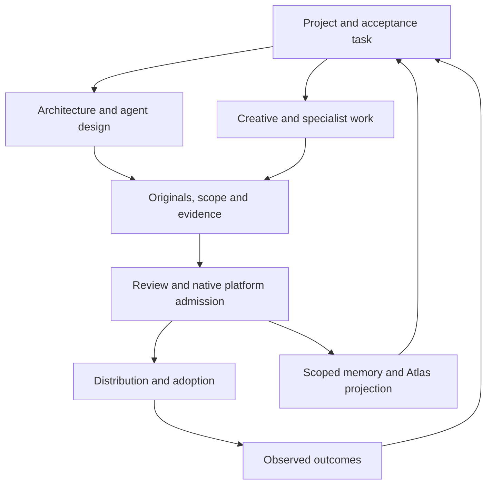

# How the Starlight specialists fit together

Working draft · 21 October 2026 · Operational implementation and adoption guide.

Bring a project to the specialist that can advance it. Architecture makes the layers and decisions explicit. Agent Designer improves a bounded agent job. GenCreator turns source into finished work. Marketing explains demonstrated value and measures adoption. Music Studio works through Songcraft and the artist's catalog. Memory carries scoped continuity. Plugin Forge makes the methods installable. Atlas shows a private project view, and n8n runs inspected, authorized automations.

These capabilities keep their native contracts. The [handoff adapter](../../foundry/ecosystem/README.md) carries their artifacts together without inventing another registry or orchestration runtime.

## Keep the existing owners

| Layer | Responsibility | Integration boundary |
| --- | --- | --- |
| Portfolio | Existing reviewed Registry | Brands, repositories and accepted architecture remain there |
| Portable methods | Existing skills and plugin owners | Versioned instructions, examples, scripts and licenses |
| Project transport | This operational adapter | Originals, declared scope, source references and an index |
| Product experience | Existing Starlight application | Workspace import, identity, editable state and recovery |
| Execution | The product's admitted workflow owner | Real tool grants, budgets, retries, cancellation and settlement |
| Business state | Existing relational application data | Membership, entitlements and actual payment/usage records |
| Human view | Existing Atlas records | Versioned private projections with links to source |
| Learning and distribution | GenCreator, Marketing and FrankX | Finished work, accurate claims and observable adoption |

The adapter writes a transport projection, not business state. It does not reserve credits. A native app import does not approve an agent, admit a run or commit a memory. An architecture ADR does not mean Agentic Detection and Response. Keep names and authority precise.

## What can be tried now

Run the dependency-free example, carry authorized original files from different tools, merge contributions for the same selected scope, reopen the exact bytes, and import the five-file projection through the existing Memory Studio path. Run the tests and inspect the code before using sensitive work.

The original source export remains required. ChatGPT, Claude, Gemini and Grok do not acquire a shared history from these instructions. Local HTML and code are carried as files; they are never executed by the handoff tool.

The local tests cover transport integrity and failure behavior. Host-native installation, actual cross-host tasks and hosted account journeys remain separate compatibility rows. A successful private plugin save establishes a stored release, not installation on every machine.

## Engineering that makes the experience seamless

| Work | Acceptance evidence | Existing owner |
| --- | --- | --- |
| Select project once | The same project/brand/scope reaches every native job; mismatch is rejected | Product workspace and native identity |
| Receive specialist artifacts | An import preview shows source, originals, changes and conflicts before state changes | Platform import/recovery |
| Continue a native run | Validated output maps to the current factory or agent schema without widening permissions | Existing workflow engine |
| Connect accounts | Explicit scoped delegation, revocation and expired-credential recovery | Product connector boundary |
| Meter useful execution | One reservation, idempotent settlement, refunds/reconciliation and per-job evidence | Existing ledger/admission code |
| Route intelligence | Eligibility and permission filters precede cost ranking; fallback preserves them | Existing router and eval owners |
| Resume across devices | Another admitted device retrieves the same owner-bound revision | Existing identity/data/memory path |
| Trust a release | Native loader plus task test on each supported host, rollback and rights/license checks | Forge and release/eval owners |
| Explain and teach | A runnable example, accurate status and a learner variation | FrankX and Academy |

A useful hosted next step is an import preview and native factory adapter over this transport. Keep the current account, recovery, factory and ledger contracts; do not introduce a second wallet or job queue. Device work can be useful before funded cloud execution is activated.

## Evaluate improvement honestly

Freeze representative tasks across system design, creative production, marketing, music, memory recovery and workflow failure. Save current and candidate outputs before changing the rubric. Use independent review for subjective quality; a listening evaluation requires actual audio. Record acceptance rate, critical mistakes, review effort, elapsed time, replay/recovery behavior and observed spend. Do not combine these into a flattering unexplained score.

For each host, record proposed, source-built, schema-checked, task-tested, account-saved, installed, deployed, operating and customer-validated independently. Check only the states with evidence. Keep the test corpus and anonymized failures with the existing eval owner. A compatibility matrix earns its green cells one task at a time.

## Help another person adopt it

Offer three entry paths: inspect a finished example; run the local handoff without new subscriptions; or use an already admitted platform workflow. Document prerequisites, permissions, actual cost boundaries, original-file recovery and the place to report a failure. A newcomer should not need Frank's private Registry, artist catalog or personal machine configuration to run the public example.

Teach a variation: change the brand and verify that the old scope is rejected; change a source file and verify that its old packet no longer passes; change the audience and rerun the native production/review task. The method is useful when a learner can make the next result independently.

## Fund expansion from delivered value

Begin with a bounded paid implementation or reusable artifact whose delivery cost can be observed. Charge recurring fees for ongoing value and support only after that work repeats. Add usage credits when native measurement, admission, reconciliation and refund rules operate end to end. Consumer subscriptions do not become resale API credits.

Reinvestment is a policy proposal: retain taxes, refunds, delivery obligations and an operating reserve before funding the next experiment from realized margin. Actual available cash, hardware, paid access and contribution margin require owner evidence. The adapter makes no purchases and promises no earnings.

## Publication

Launch content should carry a working example, a source revision, the actual checks, one useful rejected alternative and the remaining engineering. A blog, preview, signed release, paid run and accepted customer outcome are different pieces of evidence. Update the explanation when the implementation changes.

Voice source: `starlight-design-intelligence@3d6fc8fdd38b5db69a16db1078e30d454e891af1`, Starlight voice direction, proposal-preview snapshot. The examples express the authorized direction; they are not availability claims.

Built on SIP — existing file portability, provenance and human-control practices; operational adapter only.
