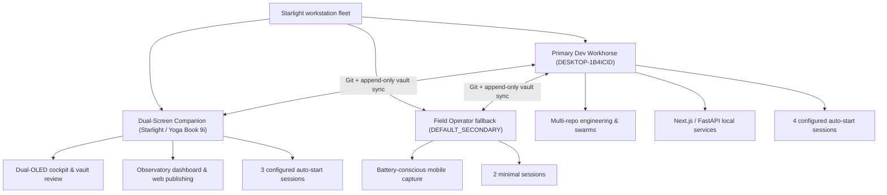

# Multi-laptop operating and session recovery strategy

This document defines machine roles, repository path resolution, sync boundaries, and agent session recovery across Frank's Windows workstations.

---

## 1. Machine profiles

Machine profiles live in [`memory/agent-sessions.json`](../../memory/agent-sessions.json) and are matched case-insensitively against `$env:COMPUTERNAME`.



### Primary Dev Workhorse (`DESKTOP-1B4ICID`)
* **Role:** Heavy multi-repo engineering, local service execution, and parallel agent coordination.
* **Auto-start sessions:**
  * `Starlight-Intelligence-System` (`clsis` — Claude Code)
  * `Arcanea` (`agyarc` — Antigravity, resolves `Arcanea` or `arcanea-ai-app`)
  * `FrankX` (`agyfx` — Antigravity)
  * `agentic-creator-os` (`cdacos` — Codex)
* **Resource safeguard:** Keep at least 2048 MB free RAM and avoid orphaned MCP child processes during restarts.

### Dual-Screen Companion (`Starlight` — Yoga Book 9i)
* **Role:** Dual-OLED cockpit monitoring, strategic memory review, and lightweight web publishing across `$HOME` or `$HOME\starlight\repos`.
* **Auto-start sessions:**
  * `Starlight-Intelligence-System` (`clsis` — Claude Code)
  * `starlight-command-center` (`observatory` — opens the live cockpit dashboard or `starlight-command-center` workspace)
  * `frankx.ai-vercel-website` (`agyfxp` — Antigravity)

### Field Operator fallback (`DEFAULT_SECONDARY`)
* **Role:** Default profile used automatically when `$env:COMPUTERNAME` has no explicit entry in [`memory/agent-sessions.json`](../../memory/agent-sessions.json).
* **Auto-start sessions:**
  * `Starlight-Intelligence-System` (`clsis` — Claude Code)
  * `FrankX` (`agyfx` — Antigravity)

---

## 2. Dynamic path resolution & sync boundaries

1. **Multi-root path resolution:** [`scripts/restart-all-agents.ps1`](../../scripts/restart-all-agents.ps1) checks the configured `path`, `$HOME\<name>`, `$HOME\starlight\repos\<name>`, and the parent folder of the active `Starlight-Intelligence-System` checkout. Missing directories are reported cleanly and skipped rather than failing the run.
2. **Portable command bootstrap:** Each spawned Windows Terminal tab dot-sources [`scripts/agy-tools.ps1`](../../scripts/agy-tools.ps1) directly with its target launcher command (`clsis`, `agyarc`, `agyfx`, `cdacos`, `observatory`, `agyfxp`), so sessions start reliably even on a secondary laptop before `$PROFILE` customization.
3. **Append-only vault logs:** Semantic vaults write append-only JSONL records so P2P/Syncthing and Git stay conflict-free across laptops.
4. **Local credentials only:** Secrets stay in gitignored `private/.env.local` or `.env` files and are never committed.

---

## 3. Session recovery & lifecycle commands

Once [`scripts/agy-tools.ps1`](../../scripts/agy-tools.ps1) (or `.agent-harness\command-grid.ps1`) is loaded in PowerShell, use these commands from any directory:

| Command | Action |
|---------|--------|
| `restart-all` (or `restart-agents`) | Stops running configured sessions (preserving the caller's own shell if invoked from inside an agent) and relaunches clean Windows Terminal tabs |
| `start-agents` (or `start-all`) | Launches only configured sessions that are not currently running |
| `agent-status` | Inspects active process trees and refreshes [`cockpit/agent-status-data.js`](../../cockpit/agent-status-data.js) |
| `kill-agents` (or `stop-agents`) | Terminates configured agent shells and their child process trees cleanly |
| `observatory` | Opens [`cockpit/agent-control-center.html`](../../cockpit/agent-control-center.html) after refreshing status |

### Direct script flags

You can also invoke [`scripts/restart-all-agents.ps1`](../../scripts/restart-all-agents.ps1) directly with `-NoProfile`:

```powershell
# Refresh status snapshot without touching running terminals
pwsh -NoProfile -File .\scripts\restart-all-agents.ps1 -Action Status

# Preview a full restart without closing or spawning windows
pwsh -NoProfile -File .\scripts\restart-all-agents.ps1 -Action Restart -DryRun

# Restart only specific repositories or commands
pwsh -NoProfile -File .\scripts\restart-all-agents.ps1 -Action Restart -Target sis,FrankX
```

### Background watchdogs

* **Desktop launcher watcher (`scripts/watch-launcher.ps1`):** Watches `private/launcher-trigger.txt` so headless background tasks can request visible Windows Terminal tabs on the interactive desktop.
* **Agent watchdog & machine heart (`scripts/heart-check.ps1`):** Audits scheduled tasks, daemons, and process health across the workstation.
