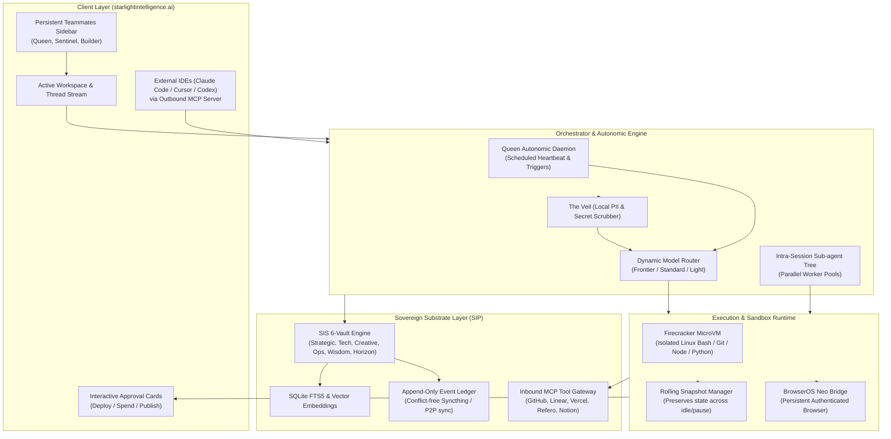

# Starlight Teammates — Systems & Engineering Architecture Specification

> **Substrate Attestation:** Built on SIP (Starlight Intelligence Protocol) § 2  
> **Status:** Active Engineering Specification  
> **Target Surface:** `starlightintelligence.ai`  
> **Author:** Antigravity (Advanced Agentic Systems Architect)  
> **Canonical Path:** `docs/specs/starlight-teammates/ARCHITECTURE.md`  
> **Date:** 2026-11-09  

---

## 1. High-Level System Architecture

Starlight Teammates is structured as a 4-tier decoupled architecture:
1. **Presentation & Interaction Layer:** Next.js / React 19 web application on `starlightintelligence.ai` with streaming SSE, split-pane workspace, and interactive approval cards.
2. **Orchestration & Routing Engine:** Multi-model router, agent state machine, and autonomic scheduler (Queen Loop daemon).
3. **Execution & Sandbox Layer:** Secure, isolated microVM compute environments (Firecracker / Cloudflare Containers) with rolling state snapshots.
4. **Sovereign Substrate & Memory Layer:** SIS 6-Vault hybrid engine (SQLite FTS5 + JSONL append-only log + pluggable local/remote embeddings) accessible via MCP.



---

## 2. Sandboxing Engine: MicroVMs & Rolling Snapshots

### 2.1 The Problem of Agent Execution
Autonomous digital workers require persistent shell, filesystem, and network capabilities to inspect repos, run test suites, build artifacts, and stage pull requests. However:
- Running untrusted code directly on the host poses severe security risks.
- Standard Docker containers lack hardware virtualization isolation and cannot freeze/snapshot long-running state cheaply.

### 2.2 MicroVM Architecture (Firecracker / SPACE-equivalent)
Starlight Teammates deploys **lightweight Firecracker microVMs** (or managed microVM infrastructure such as E2B, Modal, or Cloudflare Sandboxes):
- **Boot Time:** < 150ms per ephemeral environment.
- **Resource Footprint:** ~5MB baseline memory per VM, scaling dynamically based on task load.
- **Root Isolation:** Dedicated Linux kernel, private network namespace, and sandboxed loopback filesystem.

### 2.3 Rolling State Snapshots
Tasks assigned to teammates often span several hours or days (e.g. comprehensive repo refactors, deep market research). To prevent idle resource drain while preserving context:
1. **Checkpointing:** After each major tool execution or milestone, the sandbox daemon takes a COW (Copy-On-Write) snapshot of the filesystem and memory delta.
2. **Context Suspension:** If a teammate awaits human approval via an Approval Card, the microVM suspends to disk at zero compute cost.
3. **Instant Rehydration:** When the operator clicks "Approve", the exact memory state and shell environment rehydrate in < 500ms.

---

## 3. Dynamic Model Routing & Token Optimization

To prevent the credit-burn phenomenon observed in proprietary systems (e.g. 199 out of 206 credits consumed by frontier models on basic operations), Starlight Teammates employs an **Intent-Based Dynamic Model Router**:

| Tier | Default Models | Assigned Operations | Target % of Calls | Cost Multiplier |
| :--- | :--- | :--- | :--- | :--- |
| **Light (Speed)** | Google Gemini 4 Flash / Argon, GPT-6.1 Sol, GLM 5.3, Kimi K2.6 | Web scraping, data extraction, JSON validation, commit message generation, syntax linting | 60% | 0.05x |
| **Standard (Workhorse)** | Anthropic Claude Sonnet 5.5, Gemini 4 Argon | Coding, component writing, PR drafting, skill execution, conversational interaction | 30% | 0.3x |
| **Frontier (Reasoning)** | Anthropic Claude Opus 5.5, GPT-6 Astra, Claude Fable 5.1, OpenAI o4/o5 | Architectural design, cross-vault synthesis, multi-agent conflict resolution, council decisions | 10% | 1.0x |

### Intra-Session Sub-agent Isolation
When a teammate executes a heavy research or indexing task:
- The parent session spawns 3 to 5 ephemeral worker agents on the **Light Tier**.
- Workers execute in parallel, reading web pages or codebase chunks in their own temporary context windows.
- Workers write distilled Markdown/JSON summaries to the shared `/home/user/workspace`.
- The parent session reads only the distilled outputs, preventing raw token bloat from compounding across turns.

---

## 4. Sovereign Memory Substrate: SIS 6-Vault Integration

Unlike Perplexity’s closed "Project Brain", Starlight Teammates binds directly to the **Starlight Intelligence System (SIS)** memory architecture:

### 4.1 The Six Vaults
1. **Strategic Vault (◆):** Past business, architectural, and estate decisions with outcomes and rationales.
2. **Technical Vault (⬡):** Empirically validated code patterns, framework constraints, and API contracts.
3. **Creative Vault (✦):** Brand registers, aesthetic guidelines, typography tokens, and voice rules.
4. **Operational Vault (▸):** Work logs, Queen advance states, workflow checklists, and session transcripts.
5. **Wisdom Vault (◎):** Cross-domain heuristics, compounding insights, and lessons learned.
6. **Horizon Vault (↗):** Append-only long-term roadmap and vision ledger.

### 4.2 Hydration Protocol
When a Teammate thread awakens:
1. **Session Context Load:** The agent queries `sis_vault_search` and `sis_recent_entries` for relevant knowledge atoms matching the teammate's domain.
2. **Continuity Status Check:** Loads active goals via `sis_goal_status`.
3. **Active Skills Injection:** The agent inspects `skills/skill-rules.json` to mount relevant domain capabilities dynamically.

---

## 5. Bidirectional Model Context Protocol (MCP) Mesh

Starlight Teammates functions as a dual-role MCP node:

```
[External IDEs] ──(Outbound MCP Server)──> [Starlight Teammates Core] ──(Inbound MCP Client)──> [Tools & Services]
  Claude Code                                                                                       GitHub
  Cursor                                                                                            Vercel
  Codex CLI                                                                                         BrowserOS Neo
  OpenCode                                                                                          Refero Design
```

### 5.1 Outbound MCP Server (`starlightintelligence.ai/mcp`)
Exposes tools for external developer environments:
- `sis_teammate_query(teammate_id, message)`: Dispatches a task to a background teammate.
- `sis_teammate_status(task_id)`: Checks progress and pulls draft artifacts.
- `sis_vault_lookup(vault, query)`: Reads from sovereign memory.

### 5.2 Inbound MCP Client
Teammates consume local and cloud MCP servers:
- **`browseros-neo`:** Direct interaction with persistent, authenticated user browser sessions.
- **`refero`:** Visual research over 100,000+ real-world product screens and user flows.
- **`github` & `vercel`:** Staging PRs, reading issues, and monitoring preview deployments.

---

## 6. Security, Isolation & The Veil Gateway

1. **The Veil (PII & Secret Scrubber):** Every payload leaving the user's sovereign boundary is sanitized by local regex and entropy filters, redacting API keys, passwords, and sensitive identifiers.
2. **Fail-Closed Financial Gate:** Any instruction requiring funds movement (e.g. paying an invoice, ordering a domain, purchasing compute) immediately halts and emits an interactive `ApprovalCard(action="FINANCIAL_TRANSACTION")`. Autonomous execution is physically blocked at the schema level.
3. **Non-Overlapping Git Trees:** When teammates stage code changes, they work strictly in isolated branch namespaces (`agent/<teammate-name>/<scope>`), preventing concurrent tree corruption.
