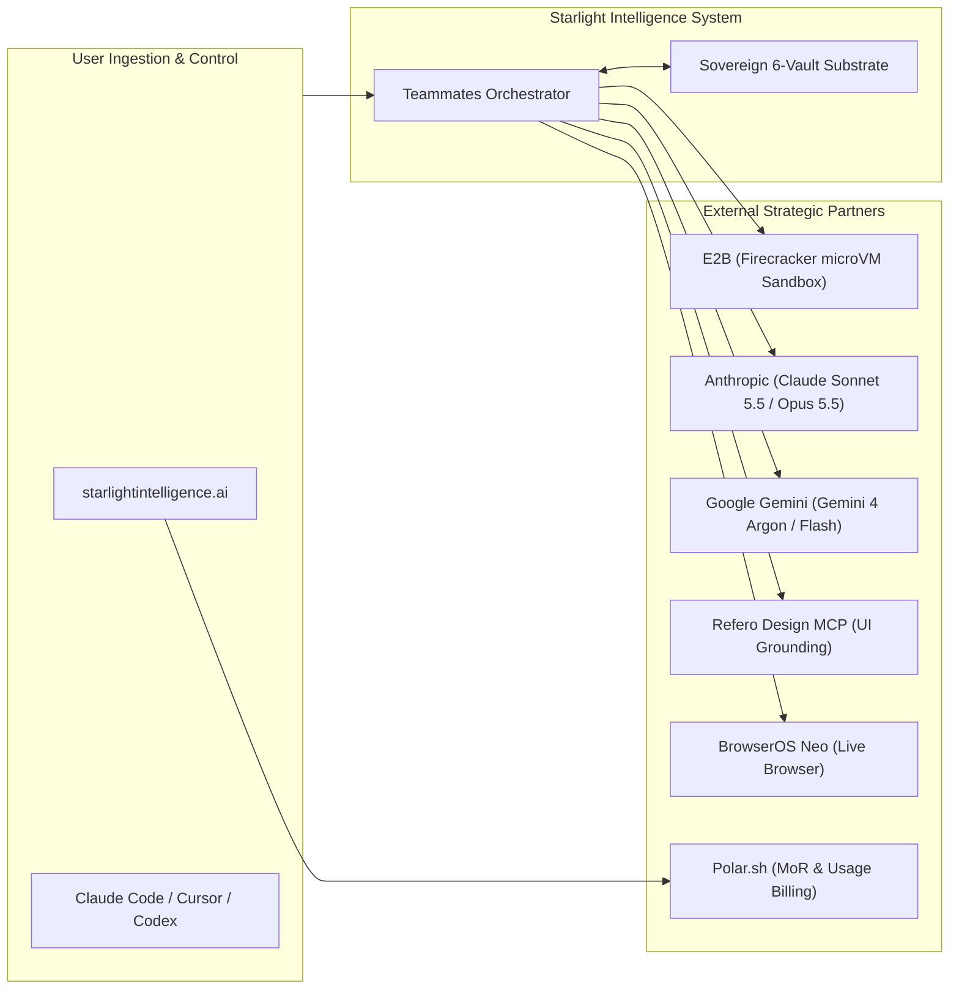

# Starlight Teammates — Partner, Vendor & Strategic Infrastructure Matrix

> **Substrate Attestation:** Built on SIP (Starlight Intelligence Protocol) § 3  
> **Status:** Strategic Vendor Architecture  
> **Target Surface:** `starlightintelligence.ai`  
> **Author:** Antigravity (Advanced Agentic Systems Architect)  
> **Canonical Path:** `docs/specs/starlight-teammates/PARTNERS.md`  
> **Date:** 2026-11-09  

---

## 1. Executive Context: Who Perplexity Works With

Through decompilation and empirical inspection, Perplexity’s **Computer & Teammates** infrastructure relies on the following vendor ecosystem:

| Layer | Perplexity Partners | Implementation Purpose |
| :--- | :--- | :--- |
| **Compute & Sandboxing** | **Akamai, Crusoe, CoreWeave** | Hosting the **SPACE Sandbox Platform** using Firecracker microVMs across distributed edge nodes and GPU cloud infrastructure. |
| **Foundation Models** | **Anthropic, Google, OpenAI, GLM** | Multi-model routing pool (~20 models) dynamically assigned to subtasks based on context size and reasoning depth. |
| **Connectors & Data** | **Salesforce, Snowflake, HubSpot, Datadog, Google Workspace** | Enterprise OAuth integrations allowing agents to read CRM, data warehouse, and log streams. |
| **Hardware & Networking** | **NVIDIA / Cloud Hyperscalers** | Low-latency inference clusters and high-bandwidth interconnects for multi-agent parallel trees. |

---

## 2. Who Starlight Intelligence Should Work With

To deliver **Starlight Teammates** on `starlightintelligence.ai` while maintaining **sovereign data control, token cost-efficiency, and rapid execution velocity**, Starlight should partner with the following best-in-class providers:

### 2.1 Sandboxed Execution & MicroVMs

| Provider | Suitability Score | Architecture Fit | Trade-offs & Strategic Decision |
| :--- | :--- | :--- | :--- |
| **E2B (Firecracker microVMs)** | **9.5/10 (Primary Cloud Sandbox)** | Purpose-built for AI agents. Sub-150ms start times, isolated Linux environment with Python/Node/Git, native session snapshotting and pausing. | **Recommended for multi-hour background agent tasks.** Seamless API, eliminates managing bare-metal hypervisors. |
| **Cloudflare Sandboxes / Workers Containers** | **9.0/10 (Edge Execution)** | Ultra-low latency edge runtime. Native to Frank’s existing Cloudflare infrastructure (already active in account). | **Recommended for lightweight web scraping, validation, and webhook handling.** Zero cold-starts. |
| **Daytona / Railway** | **8.5/10 (Persistent Development)** | Full persistent dev environments with SSH and Git hooks. Ideal for long-horizon coding tasks. | **Recommended for complex multi-repo refactoring** where environments persist across weeks. |
| **Akamai / Crusoe / CoreWeave** | **7.0/10 (Bare Metal Scale)** | High capital expenditure; requires custom hypervisor operations team. | **Avoid for Phase 1.** Revisit when reaching 10,000+ concurrent enterprise microVMs. |

### 2.2 Foundation Model Routing Ecosystem

| Provider | Models Deployed | Assigned Role in Starlight Teammates |
| :--- | :--- | :--- |
| **Anthropic** | Claude Sonnet 5.5, Claude Opus 5.5, Claude Fable 5.1 | **Lead Architect & Code Synthesizer.** Claude Sonnet 5.5 is the workhorse for high-speed coding and PR drafting. Claude Opus 5.5 and Claude Fable 5.1 handle deep multi-agent council reasoning and creative synthesis. |
| **Google Cloud (Gemini API)** | Gemini 4 Argon, Gemini 4 Flash / Pro | **High-Velocity Ingest & Research.** Gemini 4 Argon offers massive 2M+ context windows for reading large enterprise codebases and multi-repo trees at minimal token cost. |
| **OpenAI** | GPT-6 Astra, GPT-6.1 Sol, o4 / o5 | **Deterministic Logic & High-Speed Subagents.** GPT-6.1 Sol for instantaneous subagent sweeps; GPT-6 Astra and o4/o5 for rigorous mathematical verification and schema compilation. |
| **OpenRouter / Specialized Swarms** | GLM 5.3, Kimi K2.6, DeepSeek V4 | **Ultra-Low-Cost Background Swarms.** GLM 5.3 and Kimi K2.6 deliver minimal credit burn for 24/7 background sweeps, linting, and scheduled morning cron tasks. |

### 2.3 Visual Design & Interface Intelligence

| Partner / Tool | Integration Mechanism | Strategic Value |
| :--- | :--- | :--- |
| **Refero Design (`refero.design`)** | **Direct MCP Server (`https://api.refero.design/mcp`)** | **Verified Live.** 100,000+ real product screens, user flows, and curated design styles. Grounding Starlight UI directly in shipped, battle-tested interfaces (Linear, Factory.ai, Dock.us) rather than synthetic model hallucinations. |
| **21st.dev** | **21st CLI** | Curated registry of accessible Tailwind + React component primitives. Used surgically to retrieve missing UI components without importing monolithic packages. |
| **BrowserOS Neo** | **BrowserOS MCP Bridge** | Persistent, authenticated browser session profile for live verification, web research, and OAuth handshake flows without fragile headless scrapers. |

### 2.4 Payments, Billing & Merchant of Record (MoR)

| Provider | Suitability | Why it Matters for Starlight Teammates |
| :--- | :--- | :--- |
| **Polar.sh** | **Recommended MoR** | Built specifically for developer tools and AI products. Native support for per-seat teammate pricing, token/credit usage metering, GitHub sponsorship sync, and low fees. |
| **Lemon Squeezy** | **Alternative MoR** | Full global tax handling, easy subscription tier setup. Great fallback if Polar lacks local banking in specific regions. |
| **Stripe Billing** | **Direct Processor** | Ideal for custom enterprise contracts, but requires manual VAT/sales tax registration across jurisdictions. |

---

## 3. Strategic Partner Integration Architecture

---

## 4. Phased Partnership Rollout

- **Phase 1 (Immediate / Q4 2026):**
  - **Models:** Anthropic API (Claude Sonnet 5.5) + Google Gemini (Gemini 4 Argon / Flash) + OpenAI (GPT-6.1 Sol).
  - **Sandboxing:** E2B SDK + local Cloudflare Workers for edge hooks.
  - **Design Grounding:** Refero MCP (active with Pro token).
  - **Billing:** Polar.sh for sovereign teammate subscriptions ($29/seat/mo or usage-metered).
- **Phase 2 (Scale / Q1 2027):**
  - Deep integration with Daytona / Railway for persistent multi-device dev environments.
  - Direct peering with Crusoe/CoreWeave if self-hosted model fine-tunes are chartered.
